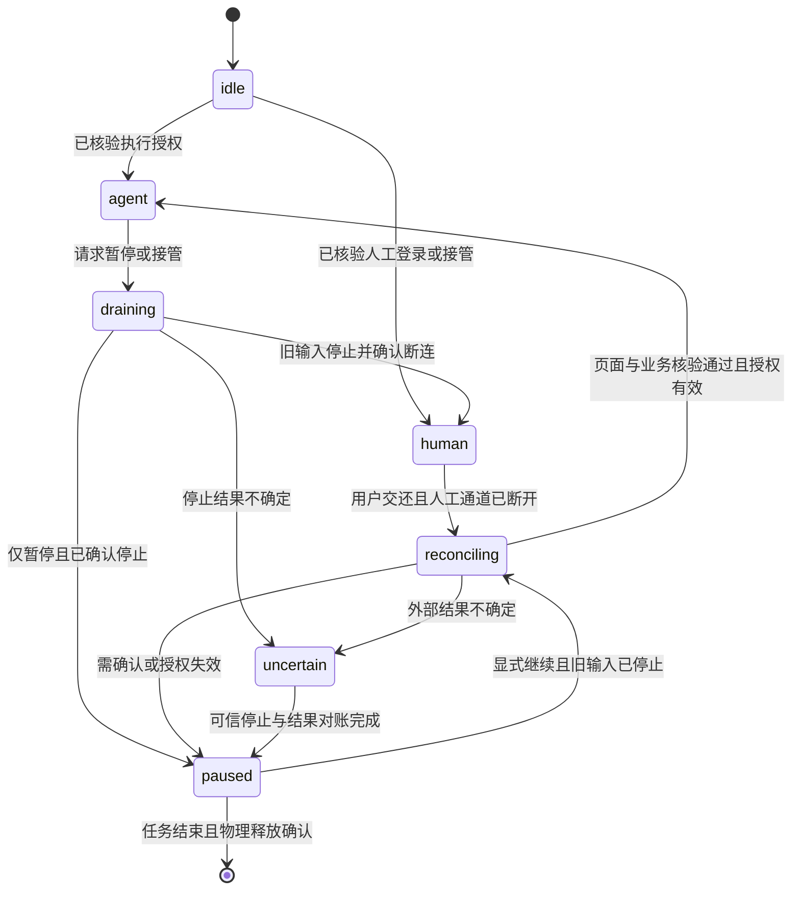

# BOSS 招聘沟通实施方案

状态（2026-10-12 校准后执行）：Phase 0A 合成工作面与连接请求已实现；真实新登录保存与新会话恢复已通过。Phase 1.1 的只读现场与跨站生命周期已接入，完整控制矩阵尚未通过。Phase 1.2 已接通 HTTP 只读任务、Web/BFF 和观察持久化；39 条摘要与一个指定会话的当前加载消息已在 `/inbox` 核验并回读，首次 5 条、最新复验 8 条，归属、稳定消息标识、方向、时间及最新消息一致性通过；1 张历史简历卡片已核验并保存。该结果不代表全部历史或发送成功；当前材料身份、发送条件及控制交接仍待完成，当前不能无人值守回复或发送简历。当前目标、必要底层修复与后续门槛统一见第 5 节。

## 1. 问题和首个结果

此前已确认的首个主动触达目标，是让职业 Agent 在 BOSS 直聘上完成一条可追溯的真实闭环：

```text
指定岗位/岗位列表
  → 读取岗位与招聘方会话
  → 按职业目标、硬约束和已确认事实判断
  → 生成带依据的个性化打招呼草稿
  → 受限授权
  → BOSS 页面发送
  → 页面状态核验
  → 成功/失败/未知结果报告
```

原实施基线以单用户、单 BOSS Profile、单岗位或小批量岗位、首次打招呼为首个结果。用户随后确认主动触达与来信处理都迫切需要；当前统一顺序以第 5 节为准，1.3 保留调整依据。

原主动触达首版不包含 HR 后续自动回复和简历卡发送，因此不能按该基线交付用户目前最迫切的来信值守需求。全网岗位巡检、无限期无人值班、逆向 BOSS 私有 API、绕过验证码/风控和无证据的“成功”提示仍不纳入首个闭环。

### 1.1 使用形态和入口

这条能力不能只存在于 Agent 的一句自然语言回复里。它需要同时有一个可找回的招聘沟通工作面，
以及可以暂停、查看和撤销的持久任务。当前 Web 已有 `/inbox`（招聘沟通）、`/tasks`（Agent 工作）、
`/automations`（持续委托）和 `/reports`（工作结果）四个过渡页面。
入口已经加入展开和收起侧栏；`/inbox` 的 BOSS 连接请求已持久化，其余列表仍是合成数据，
真实招聘方会话、沟通任务和调度尚未接入。

首版采用两条互相汇合的入口：

1. **左侧显式入口：招聘沟通。** 放在“搜索能力”和“职业背景”附近，打开招聘沟通工作面；页面展示待处理会话、
   已生成草稿、运行中的任务、需要登录/验证码/人工核对的事项和最近结果。入口名称使用“招聘沟通”，不使用“HR 自动化”，
   以覆盖主动打招呼、后续消息和结果核对。
2. **对话委托入口：Agent。** 用户可以直接说“帮我筛选并给这些岗位打招呼”。Agent 先返回结构化的岗位范围、匹配依据、
   草稿和下一步按钮；用户可以把它保存为一次性任务，或明确转换为定时委托。普通聊天文本本身不创建外部写操作授权。

招聘沟通工作面提供“新建沟通任务”入口，但不复制一套岗位表单。它只收集任务范围、运行方式和授权边界，岗位与消息内容
仍由只读适配器和 Agent 结果卡带回；岗位详情和证据在右侧内容标签打开，浏览器现场按 1.4 的共用组件承载。任务卡必须清楚区分：草稿、等待用户、运行中、
已发送、结果未知、失败和已完成。

### 1.2 聚焦工作面，而不是半栏内容标签

“招聘沟通”是一个需要用户持续处理的主工作面。用户从左侧点击它时，系统应进入招聘沟通的聚焦模式：保留全局项目/对话侧栏，
将中间 Agent 区与右侧内容区合并为可用的主工作区域，展示会话、任务、定时委托和结果。当前已实现聚焦入口；
早期右侧半栏方案已替代，不再作为待实施任务。

聚焦模式遵循以下行为：

- 进入招聘沟通后，主内容占据剩余工作面；不让聊天输入框持续占用一半宽度，也不把列表压缩成辅助栏。
- 从 Agent 对话打开招聘沟通时，原对话、草稿和运行状态保留；用户可以返回原对话，返回不会取消任务、撤销授权或关闭外部会话。
- 从招聘沟通里查看单个岗位、HR 会话或任务证据时，使用右侧标签或详情抽屉；浏览器现场使用 1.4 的停靠区。关闭详情回到招聘沟通列表，不回到空白页。
- 在窄屏上使用整页切换；“返回对话”是明确的页面动作，不依赖用户猜测侧栏是否被隐藏。
- Agent 仍可作为伴随入口存在：用户可以在当前工作面打开“继续问 Agent”抽屉，或从任务卡回到原对话；伴随入口不能遮盖任务的主要状态和待处理动作。

这里需要区分三个相似但不同的对象：

1. **Agent 对话**：用户与 CareerAct Agent 的长期协作，负责理解意图、读取职业上下文、判断岗位和生成草稿。
2. **招聘方会话**：用户与 BOSS 招聘方之间的外部消息记录，保存岗位关联、原始消息、已核验回复和待处理事项；它不是 Agent 对话的替代品。
3. **沟通任务/定时委托**：驱动读取、匹配、草稿、授权、发送和核验的执行对象；它可以由 Agent 对话创建，也可以从招聘沟通工作面创建。

Pulse 中类似 IM 的入口说明了“外部会话需要被找回”，但 CareerAct 不把微信式聊天窗口直接当作任务调度器。外部会话、执行任务和 Agent
对话必须通过岗位、授权和结果证据关联，分别展示状态。

一次性任务和定时委托是两种不同的产品对象：

- **一次性沟通任务**：针对当前确认的一个岗位或小批量岗位，完成读取、匹配、草稿、一次授权、发送和核验；页面关闭后由后台任务继续，
  直到完成、失败或等待人工。
- **定时委托**：用户明确开启的长期服务，按时区和频率触发只读巡检、匹配和草稿。首版默认只读和生成草稿；对外发送必须使用明确的、
  有岗位范围、数量上限、频率、材料版本和过期时间的授权。用户可在 `/automations` 暂停、恢复、撤销和查看每次运行，撤销后未执行的动作停止。

因此，Pulse 中“定时打招呼”的经验会被保留为产品需求输入，但不会把旧 scheduler 或定时器实现搬过来。CareerAct 用
Temporal Workflow 触发 `OutreachAutomation`，每次运行生成独立的 `CommunicationTask` 和 `CommunicationAttempt`，结果回到招聘沟通和报告页面。这里是设计方案，当前 Worker 尚未注册招聘沟通 Workflow 或 Activity。

### 1.3 阶段复核与来信处理优先级建议（2026-10-08）

**当前事实：** 招聘沟通仍在完成 Phase 1.1 的控制契约，Phase 1.2 的真实列表身份、最后消息标识及摘要已可持久回读；登录保存与新会话恢复已复验。完整消息详情、方向及简历条件尚未核验，读取任务因此不报告业务完成，不能无人值守回复 HR 或发送简历；最新合同证据见第 5 节。
通用文本 Runtime 已使用 Agno，但招聘消息尚未接入 Agent 工具；浏览器可登录不等于业务已能执行。

**2026-10-10 可见复验：** 保存登录快照恢复后的只读任务已在产品入口真实运行并完成物理释放；BOSS 当前返回 `/web/user/` 登录页，结构化页面状态为 `needs_login`，结果已持久化且未被标记为成功。当前 `connected` 只表示保存登录曾经核验通过，不保证平台会话持续有效；需要用户重新完成 BOSS 登录/验证后，再继续会话行和消息 ID 的只读核验。

| 路径 | 当前结果 | 缺口 |
| --- | --- | --- |
| 登录和会话恢复 | 同源可见人工登录、Cookie/localStorage 加密保存、连续两次产品恢复已登录首页、完成登录并保存后的 connected 回写通过；已释放会话的忘记登录通过隔离集成 | 真实会话只读核验、长时有效性、运行中业务任务的联合撤销与生产验收 |
| 招聘沟通工作面 | `/inbox` 聚焦入口、连接请求和登录任务为真实路径 | HR 会话、沟通任务、定时委托和报告列表仍为合成占位 |
| 站点读取 | `boss.py` 可解析提供的合成岗位 HTML | 没有实时 HR 会话/消息读取，也未核验简历发送条件 |
| 判断与执行 | 通用职业上下文和文本 Runtime 可复用 | 回复决策、材料选择、发送动作和结果核验未接入 |
| 持久值守 | Temporal 基础服务和健康 Workflow 已验证 | 无招聘巡检调度、业务 Workflow/Activity、消息去重与重启后的业务恢复 |

**偏差判断：** 架构仍符合 Agno、PostgreSQL、Temporal、Browser Service 的职责边界，暂无换栈依据。
登录兼容性问题已有真实修复证据，但模块仍未形成业务交付，不能将基础设施测试数量当作招聘沟通进度。
原 Phase 1–5 先交付首次打招呼，将来信回复与简历发送排到 Phase 5，未充分覆盖用户的近期使用需求。
PRD 6.5/6.9 已包含这些能力，无须增加产品范围；第 5 节已统一编排，两条路径分别验收。

**平台机制的证据边界：** 用户真实使用说明，主动打招呼后通常要等 HR 回复才能发简历，HR 主动联系后也可发送。
这是本轮业务依据，尚未在当前适配器中核验。实现时读取该会话的招聘方/岗位、来信方向、
附件简历或平台简历卡入口、是否可点击及是否已有发送记录；仅“有新消息”不能代表可发送。
平台提醒、已读回执不作为招聘方回复；“按钮可用”、用户授权与“已发送成功”是三个不同事实。

**建议首个结果：** 对用户指定范围内已有 HR 来信的会话，在明确授权下回复可举证的常规问题，
或按用户策略发送一次已确认的简历；将已执行、跳过和待处理结果带回 `/inbox`。
优先核对并复用 BOSS 已有附件简历/平台简历卡，不以完整简历编辑、上传或导出系统作为前置。
材料身份或版本无法确认时保留待处理，不能静默选择“最新简历”。

此次复核形成以下四个业务增量；它们的执行依赖已合入第 5 节，不作为第二套计划：

1. **连接收尾和真实只读会话。** 回写已核验的连接状态，补齐撤销；读取指定会话的 HR 新消息、
   岗位及发简历条件。保存稳定会话/消息标识和处理进度，不能只依赖未读徽标，避免打开会话后漏处理。
2. **单会话判断与受限执行。** Agno 根据已确认职业事实生成常规回复；明确简历发送触发规则、
   会话范围、材料版本和动作授权，分别实现文本回复与简历发送。首个真实发送在用户在场时验收。
3. **核验、去重和恢复。** 外部发送前落尝试，发送后回读消息/附件卡。重复读取同一消息不重复回复，
   同一材料不重复发送；结果未知先对账，不自动重发。报告能区分已完成、跳过、失败和待核对。
4. **有限无人值守。** 复用 Temporal 定时触发已验收的单会话路径，明确时区、频率、上限、期限与启停。
   验收页面关闭后运行、Worker 重启后恢复、撤销后停止未执行动作，以及登录失效或平台验证转人工。
   技术追问、事实不足或时间承诺交给用户，不用自由生成的回答维持“自动交流”。

无人值守需要运行中的服务；只验证浏览器关闭再恢复，不能证明机器休眠、服务离线时仍能值班。
用户后续确认主动触达与来信处理均迫切需要，不以改序讨论阻塞推进。两条路径共用登录、只读适配、
任务授权、核验和定时运行；先完成共同前置，再沿第 5 节落实最小业务闭环。目标使用窗口为 10 月 10 日前，
不扩展材料编辑/通用 Harness，不将未经真实验收的回复或简历发送标为可用。

### 1.4 浏览器现场与两个入口（2026-10-08 实施设计，第一条保存登录现场路径已实现）

用户明确质量和工程规范优先，使用窗口用于裁剪范围，不降低授权、互斥、恢复或真实验收标准。
浏览器现场属于完成业务必需的可观察与介入能力；与真实只读会话一起交付，不另插入一轮纯外观改造。
PRD 6.10 的内部运行轨迹指模型推理、工具 Trace；用户查看真实页面、当前动作和控制归属不等同于公开这些轨迹。

**共用组件，两种容器：** 组件按服务端的任务/会话关联打开，复用同源 Viewer、状态和控制接口。
页面容器只决定摆放方式，不创建第二个浏览器、第二份任务状态或第二套授权。
当前招聘沟通页面与现场只用于阶段功能验证，视觉与整体交互未获成品验收。
按用户确认先完成核心功能，再统一到既有 Agent 产品壳；不能把临时占位列表与诊断卡片定为最终界面。

| 场景 | 承载与展示行为 |
| --- | --- |
| `/inbox` 招聘沟通 | 主工作面内底部可折叠、可调高的浏览器停靠区；位于可见视口内，与列表分别滚动，不追加在长列表末尾。现场默认按远端 16:9 比例使用主区宽度，保留当前任务摘要；操作空间不足时放大到主工作区 |
| 普通 Agent 对话 | 同组件在右侧浏览器标签打开，保留对话和输入草稿，可调整宽度或放大。按任务打开/恢复，切换对话不把上一个任务的权限带入新任务 |
| 登录/验证/人工介入 | 当前工作面自动展开现场，显示站点、原因及控制归属；在其他对话中给可找回的待处理提示，不强行切走用户。已连接账号通过独立短时 viewer 会话恢复保存 Profile，默认只读观看，关闭现场只释放该会话 |
| 前台发起的执行 | 自动展示一次只读现场；用户折叠后尊重其选择。后台定时运行只更新状态和待办，用户可随时查看，不反复抢焦点 |
| 无活动会话/任务完成 | 不常驻空窗口；展示连接状态或结果。已保存登录不代表浏览器一直存活，查看已结束任务不能暗中创建新任务 |
| 窄屏/放大/新窗口 | 优先整页现场并提供返回；独立窗口保留为兼容入口，共用控制权规则。关闭/折叠观看不取消任务；离开人工控制须释放输入权并保持任务等待，不自动续跑 |

工具栏只放站点、关联任务、当前操作者、画面连接状态、查看/接管/交还/暂停/停止和放大等必要信息。
观看时禁止向远端滚动、输入、导航或调节 viewport；本地缩放画面不改变远端布局。
首屏尺寸应让扫码、数字、输入框和主要按钮清晰可操作；桌面完整现场以约 600px 高为验证起点，
空间不足时进入放大视图，不把页面缩成难以操作的缩略图。像素尺寸在可见验收时调整，不作为业务契约。
首次展示、展开/折叠、切换对话和列表更新不得导致整页反复重排或 Viewer 重建；同一页面内保持稳定容器身份。

画面断连必须标明断连和最后更新时间，不能用旧画面伪装实时。光标/动作高亮只能来自真实输入或执行事件；
DOM 定位没有鼠标轨迹时用简短动作状态，不模拟移动。录屏回放、多人共同编辑和任意浏览器导航暂不展开。
技术实现与控制权验收见 3.4；两入口的交付顺序见第 5 节。

## 2. 已知证据和仍需复验的事实

### 2.1 当前仓库的确定事实

- PRD 已将 BOSS 主动沟通列为正式能力，要求保存沟通内容、发送依据和处理结果。
- CareerAct 已有 Agno AgentOS/AG-UI 文本 Runtime、职业上下文工具、PostgreSQL 领域状态、Temporal 基础 Workflow 和 Browser Service 的会话租约边界。
- Browser Service 已有底座、内部控制契约、加密 context 和合成 BOSS 快照解析器；内部登录任务/授权/尝试可持久化并绑定会话注册，产品登录任务、同源 Viewer 和停止入口已接入；当前已增加受归属校验、唯一页面和大小限制保护的只读页面快照适配，实时会话消息读取、沟通领域对象和生产执行入口仍未接入。
- 浏览器执行必须通过 CareerAct 的用户归属、任务、授权、尝试和请求标识；原始 CDP/调试地址不能交给 Web 客户端。

### 2.2 历史 Pulse 的参考证据（非实现来源）

历史 Pulse 在 2026-03 对 BOSS 做过真实页面诊断和沟通执行，形成了以下记录。它们只用于提醒风险、形成实验假设和避免重复踩坑，不代表方案成熟，也不是可以直接复制的依赖：

1. 标准 Playwright/Puppeteer 的 CDP 连接曾触发 BOSS 的协议级检测，页面跳转到 `about:blank`；JS stealth、真实 Chrome UA 和拦截 `location` 都没有解决。
2. Pulse 通过 `patchright` 和长驻浏览器会话池恢复了登录、搜索、消息和职位详情页面；每次请求启动/关闭浏览器会导致会话失效风险。
3. BOSS 是 SPA：`goto` 返回不代表认证完成，必须等待异步路由稳定并持续检查登录/风控 URL。
4. 页面流程大多是确定性的：搜索列表、会话列表、职位详情、输入框和发送按钮应由站点适配器执行；视觉模型不应承担普通导航决策。
5. 页面细节不能靠猜：例如“查看职位”曾是 `span` 而非 `a`，公司/岗位字段没有稳定 class；应先采集 DOM 合同，再维护多候选选择器和 fail-loud 诊断。
6. BOSS 自带“立即沟通”可能已经发送预设招呼，额外输入一条会造成重复消息；执行前必须确认平台动作语义。
7. 外部写操作不能按 HTTP 超时自动重试；点击返回不代表平台已发送，未知结果必须进入对账或人工处理。

这些结论需要用当前 BOSS 页面和当前 patchright 版本做一次无写入 canary。历史材料不能证明今天仍然可登录或长期可用。

2026-10-07 的只读当前环境探测打开 `https://www.zhipin.com/web/geek/jobs` 后先显示“加载中，请稍候”，随后浏览器标题和 URL 变为 `about:blank`。这与历史反爬现象相符，但当前 Web 只是 Codex 的受控浏览器，不能单独证明 patchright、真实 Chrome 或用户账号的结果；它把 Phase 0 标记为“需要专用驱动实验”，没有进行登录或写操作。当前 `services/browser` 仍依赖标准 `playwright`，尚未引入 patchright。

同日使用临时 ASCII 路径的 `patchright 1.63.0` 环境和本机 Chrome 做了同目标、同等待时间的只读对照，没有加载用户 Profile，也没有登录或写操作：

| 驱动 | 10 秒后的结果 | 结论 |
| --- | --- | --- |
| 标准 Playwright | URL 变为 `about:blank`，标题为空 | 不能作为 BOSS 当前执行驱动 |
| patchright | 页面保留在 BOSS，URL 带 `_security_check`，能读取公开岗位页文本 | 驱动层可继续实验，但仍处于风控校验，不能推断已登录或可发送 |

这组结果只证明当时 Chrome/驱动组合的差异，不证明登录、持久化或写操作可用。当时下一门槛是可见人工登录后复验；后续兼容镜像与真实登录恢复证据见 Phase 0B，patchright 没有加入产品依赖，BOSS 写入口仍未开放。

2026-10-07 在当前可见隔离标签重新进行标准浏览器只读检查：目标页先显示“加载中，请稍候”，随后跳转
`/web/passport/zp/verify.html`，页面提示“当前 IP 地址可能存在异常访问行为”，要求点击按钮完成安全验证。
本次没有点击、登录、读取真实资料或执行任何写操作；验证码/安全验证必须由用户在场完成，完成后才能继续记录登录重定向、SPA 稳定时间和只读页面结构。

## 3. 架构判断

### 3.1 Agno、Runtime、Harness 的分工

这里使用的是 **Agno**，不是“ango”。不引入 Zcode/Codex Harness 作为运行时替换：

| 层 | CareerAct 采用 | 负责什么 | 不负责什么 |
| --- | --- | --- | --- |
| Agent 决策循环 | Agno AgentOS + 现有 Runtime | 上下文、模型调用、工具选择、结构化判断和草稿生成 | 不能决定外部发送已成功，不能替代业务状态 |
| 交互协议 | AG-UI | 把 Agent 进度和结果呈现给 Web | 不保存岗位、授权或发送结果 |
| 业务持久化 | FastAPI application/domain + PostgreSQL | 岗位、会话、草稿、授权、尝试、证据和状态历史 | 不依赖聊天消息作为事实源 |
| 长任务编排 | Temporal Workflow | accepted/running/waiting/failed/timed_out/cancelled/completed、信号、checkpoint | Workflow 本身不做网络、数据库或浏览器 I/O |
| 外部执行 | Worker Activity + Browser Service | 调用浏览器、租约、站点适配和页面核验 | 不让模型直接拿 CDP 或自由点击 |
| 执行 Harness | CareerAct 的工具契约、策略门、租约、幂等和回执组合 | 将模型意图变成受控的一次执行，并绑定观测、尝试和结果 | 不需要复制一个通用 Coding Harness |

Agno 可以很好复用现有对话和职业上下文；真正缺少的是招聘业务的状态、授权和外部写入语义。这个缺口用 CareerAct 的领域层、Temporal 和 Browser Service 补齐，而不是换掉 Agno。

### 3.2 为什么当前不引入 Zcode/Codex Harness

历史 Harness 研究适合帮助我们理解 loop、工具、审批、checkpoint、回放和多 Surface 边界，但它们主要面向 Coding Agent 或通用个人助手。当前任务已经有 Agno AgentOS、AG-UI、Temporal、Browser Service 和业务领域边界；引入新的 Harness 会增加状态、工具协议和恢复语义的重复实现。

只有在后续出现可复用缺口时才重新评估，例如：需要跨多个职业执行器共享统一 tool-call journal、暂停/恢复协议或离线轨迹回放，并且现有组合无法以局部适配解决。评估必须以一个具体失败样本为依据，不以“框架更成熟”作为理由。

### 3.3 DOM、Accessibility Tree 和视觉的选择

**阶段决策（2026-10-10）：** 保留“确定性主路径 + 受控视觉候选”的通用执行契约，当前不实现完整的视觉自愈系统。
这不是放弃视觉能力，而是把它放在真实 BOSS 只读闭环之后：先用 DOM/Playwright 证明页面状态、会话标识和消息结果可核验，
再用同一控制边界接入视觉候选，并以一个具体的适配失效样本决定是否扩大范围。视觉 fallback 不能直接成为发送或简历投递的授权来源。

执行顺序固定为：

1. **DOM/Playwright 站点适配器**：已知 BOSS 页面使用多候选 selector、文本/ARIA 锚点、显式等待和页面状态合同。
2. **Accessibility Tree 或结构化文本**：只用于诊断、候选元素确认或页面改版后的低风险探索，不直接授权发送。
3. **视觉/browser-use**：仅用于未知结构、适配器失效后的候选动作或人工接管辅助；候选动作必须回到确定性核验，不能直接宣布完成。

视觉方案不作为首版主路径，原因是消息发送不可逆、BOSS 流程已知、视觉点击成本和误触风险更高。任何写操作都需要发送前状态确认和发送后页面回读。

视觉 fallback 的后续接入门槛固定为：

- 由站点适配器先报告结构失效、页面改版或无法定位，不由模型自行决定绕过确定性检查；
- browser-use 只返回脱敏的候选元素/动作和置信度，动作仍经过 Browser Service 的租约、代次、任务授权和页面版本校验；
- 候选动作先用于只读观察或人工接管辅助；写操作必须停在用户确认或既有业务授权边界，执行后回读稳定会话/消息/附件标识；
- 候选定位失败、风控、验证码、页面状态不一致或结果不确定时进入 `waiting`/`unknown` 或人工接管，不自动换坐标重试；
- 视觉观察、截图和原始 DOM 不写入长期记忆，只有经过独立核验的站点/版本/动作经验才可按范围记录。

因此当前 Phase 1 的下一交付仍是稳定会话/消息 ID 的真实只读读取与控制交接；视觉 fallback 作为 Phase 1.1 的接口门槛保留，
在出现真实适配失效样本后再做最小实验。Phase 2–5 继续复用同一 Browser Service、Agno、Temporal 和业务授权边界，不新增 Harness 或站点专用视觉循环。

### 3.4 观看、控制与业务授权

**现状与缺口：** `sessions/postgres.py` 已实现持久单写者租约，`execution.py` 已有停止接收动作、
等待在途动作、断开执行器后释放的策略；不能把这些局部验证称为完整产品交接。
`app/factory.py` 现在提供明确的 control/watcher 两种 Viewer 模式：control 获取人工写租约，watcher
使用独立短时票据和 cookie、不获取写租约，服务端收到客户端输入即拒绝；两个 watcher 可并存。
活动连接注册表仍在进程内；自动执行连接边界、跨进程失效和产品化交还流程尚未闭环。
产品 `/inbox` 已接入 watcher 现场；这不代表业务控制交接已验收。
产品人工控制票据绑定短时 `boss.login`；已保存登录现场另有独立短时 watcher 记录，支持观看及关闭释放。
两者均不能授权消息巡检或发送，也不能通过改写 owner 将 watcher 升级为业务读取任务。

#### 成熟方案的依据与复用边界

以下官方资料于 2026-10-08 实际读取。公开交互模式可借鉴，未公开的内部租约实现不作推断：

| 来源 | 可复用的模式及适用边界 |
| --- | --- |
| [OpenAI Browser](https://learn.chatgpt.com/docs/browser?surface=app) | 内置页面与对话共享视野，分栏/完整视图切换；云端网页登录暂停任务，用户完成后交还，保留登录。桌面内置浏览器与云端浏览器是不同环境，不据此猜测 Codex 内部锁实现 |
| [OpenAI Computer use](https://developers.openai.com/api/docs/guides/tools-computer-use) | 运行环境保留会话、执行权限、取消和限额，并核验实际结果；这些边界不能仅交给模型指令 |
| [Steel Live Sessions](https://docs.steel.dev/overview/sessions-api/embed-sessions/live-sessions) / [Human-in-the-loop](https://docs.steel.dev/overview/sessions-api/human-in-the-loop) | 已有嵌入画面与交互开关，优先复用。托管版新流媒体与当前固定 OSS 镜像能力须区分；原始 debug URL 不提供 CareerAct 用户归属保护 |
| [Browserbase Live View](https://docs.browserbase.com/platform/browser/observability/session-live-view) | 观看、操作、按页面选择和断连事件是成熟界面模式；文档只读示例的 CSS 禁用指针是交互限制，不能替代后端权限，当前无换服务依据 |
| [Temporal Activity failures](https://docs.temporal.io/encyclopedia/detecting-activity-failures) | Activity 通过 heartbeat 接收取消，取消可能延迟；取消请求、超时或 Worker 失联都不能证明外部输入已停止 |

采用现有 Steel 画面传输 + Browser Service 控制协调 + Temporal 持久编排。先在固定兼容镜像上验证观看与执行
共存、帧确认协议、页面切换和断开行为；复用可用原生能力，仅为确定的权限/协议缺口补适配。
不因 Cloud 文档支持 WebRTC 就更换已验收镜像，不自研视频编码或复制 Coding Harness。

实现归属沿现有边界：API application 验证用户/任务/业务授权并持久化控制请求；新增产品接口遵循 `/api/v1`
的版本条件与幂等规范。Browser Service 扩展现有持久租约、Viewer 与 `ExecutorLifecycle`，负责输入准入、
连接停止和物理会话核对。Worker Activity 调用这些端口，Temporal Workflow 只编排等待与恢复；Web/BFF
只呈现状态和转发请求。Agno 不直接控制租约。业务任务/尝试与 browser schema 的控制状态各守职责，
通过明确标识关联，不互相覆盖。无需新的调度器、分布式锁服务或平行事件总线。
接口契约至少表达任务/会话/页面关联、可用动作、控制者实例、控制代次、状态版本及等待原因；
前端重连先读权威快照，再接版本化更新，拒绝过时状态。观看和输入凭据分作用域，客户端参数不能升级权限。

#### 三个相互独立的边界

1. **观看权限：** 当前用户能看哪一任务/会话/页面。只读订阅不获取写租约，不延长任务授权或物理会话寿命；
   可供同一用户多个工作面查看，但限制订阅数量。票据短时、可撤销，不暴露原始 CDP/debug URL。
2. **控制权：** 同一物理会话只有一个输入方；Playwright、browser-use、人工页面导航/输入都在此边界内。
   即使业务是“只读”，打开 HR 会话和滚动仍改变共享浏览器状态，因此自动读取也须持有控制权。
3. **业务授权：** 可回复哪位 HR、发送哪版简历、数量/期限等，仍由领域服务验证。看见或接管浏览器、
   登录成功、点击“继续”都不授予新的自动发送权限。人工在外站的自主操作在恢复时核对，不能冒充 Agent 已授权执行。

观看侧必须由服务端拒绝输入：当前已在 CareerAct cast 代理边界落地 watcher 拒绝输入；优先使用经验证的原生只读通道，否则在当前 cast 协议边界只允许经核实的画面确认/
心跳消息，拒绝键鼠、剪贴板、导航、evaluate、下载/上传及未知消息。不能靠遮罩、`pointer-events` 或 URL 参数隔离。
画面传输保持有界缓冲，慢观看者可丢旧帧/断开，不能阻塞执行器；按会话复用捕获，先验证多订阅不相互关闭流。
若固定版本不能提供安全只读传输，该门槛失败；不得把人工 Viewer 当成“已完成观看”继续开放发送。

#### 控制权交接协议

控制状态独立于任务状态；下列名称为设计语义，实施时映射现有租约与领域对象，不另建平行任务枚举。



- 请求接管先持久化意图和版本，拒绝旧执行器的新动作，等待已发出的动作结束/核验；可信执行边界确认旧连接停止后，
  才签发新人工控制凭据。等待中显示“正在交接”，不提前让用户点击；停止超时保留占用，进入待核对。
- 将现有 `lease_id` 用作每次控制代次的凭据，绑定 executor/viewer 实例和期限。多标签共用 Cookie 不能意味着
  共用人工控制权；第二个标签默认观看，抢占仍须交接。旧代次的延迟输入、续期和释放都被拒绝。
- 每个实际输入都必须经过 Browser Service 的连接/命令边界；Worker/Agent 不持有可绕过检查的原始 CDP。
  不能先在数据库 `check` 再任意发送。控制变更与动作准入要有明确串行点；已准入在途操作被记录并等待清理，
  然后才能授予下一个控制者。浏览器协议不原生理解租约，光增加版本字段不足以隔离旧连接。
- 复用当前单会话部署；先落实该会话唯一执行协调者。重启后恢复持久控制状态并核对物理连接，不能清空租约重用。
  不能确认旧输入停止时隔离/释放旧会话并核验结果；未部署和验证共享连接协调前，不扩为多 Browser Service 副本。
- 人工交还先关闭人工输入，再用受控执行器重新读取账号、站点、会话/岗位 ID、最新消息、简历版本与已有发送记录。
  页面变化使旧元素句柄、坐标、草稿依据失效；必要时重生成草稿。点击“已完成”不等于问题解决或授权续期。
- 接管可暂停整个浏览器任务，不能只暂停模型循环。Temporal 使用现有 Signal/Update、Activity heartbeat 和取消机制
  协作；Browser Service 执行准入立即停止新输入，Workflow 等可信停止结果。控制请求有幂等键和版本条件，
  领域写入与 Workflow 通知之间允许重投/核对，不能让通知丢失导致 UI 与实际控制权不一致。
- 任务/授权撤销先阻止新动作，再清理通道；发送已在途时，停止不代表撤回消息。保存 `unknown` 并对账，
  不按 Temporal 默认重试重发；读取和同一控制请求的幂等重试不等于允许重复外部发送。

#### 断线、隐私与招聘业务的具体恢复

| 情况 | 要求 |
| --- | --- |
| 仅观看断线/折叠 | 当前已授权任务可继续，前端重连原会话并拉取权威状态；不得新建任务或自动获得人工输入权 |
| 人工控制断线/关闭标签 | 禁止该实例后续输入，可信断连后保持任务等待；重连重新取得控制权，不因用户离开而自动恢复 Agent |
| 控制协调、数据库或执行器失联 | 停止新动作并保留未知占用，核对旧控制者后才恢复；租约 TTL 到期不作为旧动作已停止的证据 |
| 等待人工超时/单实例资源被占 | 有界等待、可见倒计时和延长/停止入口；到期核验并释放会话，任务保留可恢复原因。其他任务排队，不抢占人工或未知会话 |
| 人工换 HR、修改输入或已发消息/简历 | 恢复前重新读取稳定会话/消息标识与材料；更新处理进度，废弃过时草稿，避免人工已发送后 Agent 再发一次 |
| 打开消息导致平台未读消失 | 用已持久化消息标识和处理进度续跑，不把未读徽标当唯一待办依据 |
| 首次登录/验证码 | 进入人工模式后暂停 Agent 对该会话的截图/DOM 采集及模型输入；观看仍只对授权用户开放，默认不留登录录屏或输入内容 |
| 定时运行时登录失效 | 停止该账号自动写入并生成可找回待处理项；下一次调度不能反复创建登录任务或占满浏览器 |

浏览器展示按任务绑定具体页面 ID；自动新开详情页时同步关联，用户在观看模式选择另一画面不能导航执行器页面。
人工输入还要绑定当前画面/页面和 viewport 版本；过时画面、页面切换或交接未完成时禁用输入，
不将缓存坐标点击投向另一位 HR。等待原因放入既有任务 `waiting`，未知外部结果保存在 attempt，不增加同义任务状态。
截图、URL 查询参数、剪贴板、Cookie 和简历正文不进入普通日志或公开报告；只保留必要的脱敏状态、操作者类别、
控制代次、时间与动作结果。连接断开/放大状态属于展示信息，不能用于宣布任务完成。

### 3.5 Computer Use 复用边界复核（2026-10-08）

本次按用户要求核对架构、实施计划、服务装配和调用点。结论：Agno / Temporal / PostgreSQL /
Steel 的职责方向仍成立，但 BOSS 首条路径已出现局部耦合，完整通用执行与业务闭环尚未装配。
当前工作是在 BOSS 场景中交付可复用的 Computer Use 能力；产品主体仍是职业 Agent。
稳定边界见 ARCHITECTURE 3.7，以下只维护当前差距与纠偏任务。

2026-10-09 补充确认：复用目标还包括文档工具和未来桌面 Computer Use，不只是在 BOSS 与官网之间换站点。
稳定边界已补入 ARCHITECTURE 2.8；跨能力任务/成果契约见
[Runtime 专题](../agent-runtime/README.md#跨能力工具与成果)。本专题仍交付 BOSS 路径，菜单扩展不作为能力实现证据。

| 核对点 | 源码证据与判断 | 处理与完成门槛 |
| --- | --- | --- |
| 通用会话/观看/Profile | `sessions/steel.py`、`lease.py`、`context.py` 的 `SiteScope`、`profiles.py` 已有按用户/站点的基础；Viewer 通道可复用 | 保留实现与固定依赖；用第二个合成站点验证相同控制路径及 Profile 隔离，不先建设站点插件平台 |
| BOSS 规则进入通用层 | API `BrowserControlClient` 原包含 BOSS 响应与 URL 校验；通用 `snapshot_guard` 原写死 `boss-page-reader` | 本轮已将读取移到 `infrastructure/boss_page.py`，复用原 signer；owner 限制移至 BOSS HTTP 入口，租约层只处理身份关联、期限和互斥；专项回归通过 |
| 站点装配与生命周期 | Browser `main.py` 固定 `BOSS_SCOPE`，`factory.py` 的生命周期同时编排 BOSS 登录/保存/判定，`BossContextReader` 同时包含存储与业务采集 | Phase 1.1 把站点登录/存储/核验回调明确放在适配边界，由可信任务绑定站点；保持已有登录路径。仅重命名或传任意 URL 不算支持多站点 |
| 任务与授权模型 | `0023_read_execution_resources` 保留原登录约束，新增只读任务的独立 BOSS 连接/材料版本引用；任务核心不再强制绑定招聘连接或浏览器 | 受理/重放/读取/取消及归属/版本/期限已通过隔离 PostgreSQL 与 HTTP 检查；日常库已升级到 0023。Viewer issuer 与执行连接仍只接原登录路径，须在执行前重验只读授权与资源；导航/发送另行授权 |
| 独立观看生命周期 | `boss_saved_login_viewers` 为独立恢复现场保存生命周期，注册时以 viewer 记录 ID 关联 task/authorization/attempt | 仅作为观看资源有效，不能转为业务任务或复制成每站一套任务系统。业务运行时观看已有任务会话；单会话资源占用按现有排队/冲突规则处理 |
| 执行控制接通 | `ExecutorLifecycle` 有通用停止/排空逻辑，但当前生产源码没有调用它；`snapshot_guard` 是无 writer 的短时采集，不能导航或承载 Agent 循环 | Phase 1.1 接通真实执行连接、动作准入、接管与交还；运行中的读取走同一控制归属。多标签、停止超时、进程重启仍须矩阵验收 |
| Agent / 持久编排 / 记忆 | Agno 已装配文本 Runtime 与领域工具；`computer_use/` 仅职责 README，Worker 只注册健康 Workflow；已有规则/笔记，浏览器经验闭环未实现 | 复用现有 Agno 工具和 Temporal 能力；CDP 客户端复用不等于 browser-use Agent 已接入。当前不新造 Harness 或把长期记忆设为消息读取前置 |
| 两入口展示 | `BrowserScene` 已能承载同源现场，但仍有 BOSS/登录文案；普通 Agent 对话未接入此组件 | Phase 2 由调用方传任务摘要、站点和权限，专页/对话引用同一会话；不为官网复制一套 Viewer |

**Runtime 与记忆衔接：** 一次沟通或投递由业务用例校验目标、上下文版本和授权；Agno 生成判断或调用受限工具，
Browser Service 执行并产生站点核验结果，API 保存领域结果。跨系统等待/恢复由 Temporal 承载，
Phase 1.1 可先用有界执行打通控制，Phase 3 外部写操作前须接入持久尝试，Phase 5 再启用周期调度。
已有职业事实、确认规则、候选笔记和 Agno Session 继续按运行专题复用。必要的执行证据在当前阶段记录，
可复用操作经验在结果核验后按站点/动作/版本提取、失效和回归；Cookie、原始 DOM、HR 正文不自动写进长期记忆。
不以历史成功经验替代当前页面核验或授权，不预建独立向量库/自学习平台。

**此次 plan 修正：** 原 Phase 1.1 要求业务接管验收，却未显式安排非登录任务授权和执行连接装配；
Phase 1.2 的合成解析也尚不能提供真实站点合同。将这些依赖补入第 5 节同一实施顺序，
形成“共同执行边界 → 真实读取 → Agno 判断 → 受限写入 → 持久值守”的完整链路。
以一个授权只读任务的用户可见结果为下一交付单位，不继续把单个内部接口或测试数量称为阶段完成。

**本次纠偏验收：** API 读取、签名命令与 HTTP 入口专项 58 通过；另运行隔离 PostgreSQL 测试 1 通过，
通用互斥以非 BOSS 的合成 reader 身份通过，BOSS 入口仍拒绝错误 owner/watcher。相关 Ruff 格式/检查、
mypy、工作区差异和秘密扫描通过。此处仅验证边界调整；两个站点的完整执行与现场复用仍是待办，
未部署服务或执行真实 HR 操作。

## 4. 领域状态和执行状态

PostgreSQL 是业务真相，建议首个增量引入以下对象；具体字段在编码前以迁移和 API 契约冻结：

下表是业务语义，不要求每行另建一套任务状态机。`CommunicationTask` / `CommunicationAttempt`
须复用演进后的执行任务/尝试关联，沟通特有字段进入业务对象；授权共用身份、期限和撤销机制，
动作/范围规则留在用例。迁移须处理当前登录专用外键与唯一性，不能只放开 kind 字符串。

| 对象 | 关键内容 | 状态示例 |
| --- | --- | --- |
| `JobOpportunity` | 平台、岗位/公司/地点/薪资、来源 URL、页面快照版本、匹配判断 | `observed` / `matched` / `rejected` / `needs_review` |
| `RecruitingConversation` | BOSS 会话标识、岗位关联、招聘方摘要、最后读取时间 | `observed` / `needs_reply` / `contacted` / `blocked` |
| `OutreachDraft` | 消息正文、引用事实、岗位依据、生成 Run、版本 | `draft` / `approved` / `sent` / `superseded` |
| `ExternalAuthorization` | 用户、平台、岗位范围、允许动作、数量/频率、材料范围、有效期、撤销时间 | `pending` / `active` / `revoked` / `expired` |
| `CommunicationTask` | 一次性或定时运行生成的具体工作、岗位范围、草稿版本、当前待处理事项 | `accepted` / `running` / `waiting` / `failed` / `timed_out` / `cancelled` / `completed` |
| `OutreachAutomation` | 用户开启的周期、时区、平台/岗位范围、运行模式、数量上限、授权引用和暂停状态 | `draft` / `active` / `paused` / `revoked` / `expired` |
| `CommunicationAttempt` | 授权、任务/尝试 ID、幂等键、页面阶段、证据摘要、错误分类 | `accepted` / `running` / `waiting` / `failed` / `unknown` / `completed` |

`CommunicationAttempt` 和 Agent Run 分开：Agent Run 完成只说明判断或草稿完成，不能代表 BOSS 已发送。`unknown` 是终态业务结果之一，不能自动转换为 `failed` 或 `completed`。

## 5. 实施阶段和验收门槛

### 当前交付与底层修复边界

本次复核调整执行粒度，不改变 PRD 范围、既定架构或 Phase 1–5 的质量门槛。
当前可验收目标是：从可恢复的登录读取一个真实 HR 会话及消息，将绑定来源的结构化结果持久化并在
`/inbox` 回读。先核实真实页面合同，再补适配与脱敏 fixture；不能继续仅凭自造的
`data-conversation-id` / `data-message-id` 合同宣称业务可用。刷新、重复读取及重新进入会话后
核对标识与归属；无法取得稳定标识时报告具体缺口，不用显示顺序、姓名或未读徽标冒充消息身份。

底层修复按其阻塞的业务验收处理，不能一概停止，也不能无限扩大：

| 当前问题 | 处理与退出条件 |
| --- | --- |
| 登录保存失败丢失现场、恢复后要求重新验证 | 当前共同前置；复用现有加密 Profile 和恢复入口，核验修复后的保存及新会话恢复。旧现场已释放与新修复未验收分别记录，不以反复扫码代替故障修复 |
| 点击坐标错误、观看可注入输入、停止/撤销与输入竞态 | 属于正确性和权限缺陷，必须修复；沿已有 Viewer、租约和停止机制局部处理，以原失败场景回归收口，不因此另造一套控制系统 |
| 业务接管、交还与重新观察尚未装配 | 保留 Phase 1 控制矩阵；现有互斥保护下先核实真实只读字段，完成交接验收后才结束 Phase 1，不能以“先做业务”为由开放无保护的并发输入 |
| 通用视觉自愈、更多执行器、完整材料编辑、纯展示细节 | 当前未证明为该会话闭环的阻塞，按原后续门槛安排；有真实失败样本时再评估最小适配，不为兼容未来提前实现 |

处理底层问题沿现有工程规范采用以下顺序：

1. 先复现并定位是 CareerAct 调用/配置问题、站点变化，还是固定上游版本的缺陷；健康接口与合成通过不能代替原失败场景。
2. 核对固定版本的原生能力、官方配置/扩展点及可用上游修复。优先直接复用或配置；升级须验证兼容与回退，不因“新版可能更好”直接替换依赖。
3. 只有确认现有能力不能覆盖具体缺口时才做最小适配。业务归属、授权、结果核验留在 CareerAct；Agent loop、调度和浏览器协议继续复用成熟组件。不得以站点适配为名重写框架能力。
4. 确认是上游缺陷才修改上游兼容层，记录固定版本、复现依据、补丁范围及可移除条件，按既有 vendor/提交规范处理；修复与业务回归通过后返回该会话闭环。

现有 Steel 局部兼容有固定镜像失败证据，见[兼容层说明](../../../infra/steel/README.md)；
这支持保留已验证修复，不证明这些补丁永远优于上游方案。后续同一层反复出问题且诊断没有新证据时，
重新比较原生配置、上游修复或局部替代的成本与验证范围，不继续叠加猜测性补丁，也不直接重写整栈。

每次底层增量围绕“解除哪个业务阻塞、如何复现与验收”收口，结果写回本专题已有阶段记录。
阶段内已授权且无阻塞的工作连续推进；阶段回顾核对真实业务结果、职责边界和剩余风险，不按每个内部接口反复请求继续。
登录、外部发送授权或关键产品取舍确需用户时明确等待条件；按本节计划实施，不把待办标为已完成。

**2026-10-12 真实列表合同与持久回读：** 新登录 finish 已返回 200，用户从产品完成保存；
后续独立会话恢复到真实沟通页。DOM 行的 `d-c` 是重复埋点值，不能作为身份；实际
`.user-list-content` 的 `dataKey` 与行组件 `uniqueKey` 均绑定 `source.uniqueId`，
`source.lastMsgId` 是安全整数。两个新恢复会话中共同的 39 条摘要会话身份和最后消息标识一致，
诊断只输出计数与比较结果，不记录实际标识、正文或凭据。

站点适配在既有 `snapshot_guard` 内复用 `cdp-use` 的只读 `Runtime.evaluate`，不启用 Runtime 遥测，
不点击、不调用私有 API，也不读取整个组件状态；仅核验当前已渲染行的组件名、列表键、
姓名及摘要与 source 一致后提取有限字段。不匹配行拒绝，字段类型、身份重复和采集大小受限。
一次实际 40 行中 39 行匹配；列表可能被虚拟化，因此结果不表示账号全部会话。
新增可选 `last_message_id` 保持历史观察兼容；摘要保留为 conversation preview，
不伪装成完整 message。空 ready、无归属/重复/未知方向消息不能令任务 completed。
签名 Browser/API 读取、持久化与产品回读已真实通过；列表摘要与完整消息分别处理。

指定会话增量已通过：0027 将目标绑定持久任务及签名命令，单写租约与 `ExecutorLifecycle`
覆盖唯一会话行的一次点击、观察及 CDP 断连；数据库行锁核验归属、尝试、授权、owner、租约代次和期限。
真实消息组件的 `mid` 与 vnode key、`uniqueId`/`friendId`、方向和时间逐项绑定，最后消息与
`lastMsgId` 一致。文本只取 `.text-content`，排除已读/送达标签；未知组件或绑定不符拒绝。
产品真实读取并保存了 5 条当前加载消息，显示“读取完成”，未发送消息或简历。
断连未确认保留控制权，捕获失败不重放点击；当前加载范围不能冒充全部历史。

最新材料线索增量：真实新恢复会话读取并保存 8 条当前加载消息及 1 张历史简历卡片。
`message-hyperlink` 下的 `hyperlink-resume` 与同一消息对象绑定，卡片标题与有限文件名字段一致后，
只保存文件名、消息侧标记和可选请求消息 ID；不采集附件地址、正文或下载内容。
真实采集曾在内部卡片渲染前完成而漏识别，现沿原有有界观察等待内部消息组件绑定，
不重放点击。卡片方向和请求关联是历史消息证据，不能据此判定附件已发送、当前材料版本或再次发送资格；
Web 明确显示此限制。当前工具栏状态仍只代表本次观察，不能把其附件标记 false 当作无简历证明。
同一字段已通过签名读取、PostgreSQL 持久回读和可见产品核对；隔离回归覆盖错误标题/对象/方向/
请求标识、未完成渲染、禁止 URL 扩展、跨用户结果不可见和刷新不重放。
本材料线索增量默认 pytest 375 passed / 128 skipped、隔离 PostgreSQL 读取专项 35 passed、
Web 126 项回归、lint/typecheck/build、冻结依赖同步、Ruff/mypy 和秘密扫描通过；
真实 BOSS 读取与产品回读另有上述证据，没有消息或简历发送。

简历入口观察已接入同一受保护读取并真实保存：`ConversationToolbar` 内唯一 `resumeBtn` 的
按钮状态、同会话 `Editor` 身份和最新消息 ID 一起核验；最新真实样本入口可用，
`choose-upload-resume.hasResume` 为 false。产品将当前页面状态拆为 `present_unidentified`、
`absent`、`unknown`；这里的 `absent` 只表示页面组件当前未报告材料，不是账号没有简历的证明。
只保存入口状态及附件标记，不读取简历正文，不把组件标记当作账号材料清单或发送许可；未知/改版结构拒绝推断。
该合同通过实际 JS 合成 DOM、解析与 API 收件人绑定回归；真实签名读取仍返回 5 条消息并保存入口状态。

下一增量是只读核实材料身份与可发送限制，并完成接管、交还后重新观察及
Phase 1 控制矩阵。发送前仍须核对岗位/会话范围、已确认材料版本、独立授权与尝试记录；
没有真实字段证据不能仅凭 HR 发过消息推断可发简历。随后接入 Agno 草稿，不重新进行登录驱动选型。
本轮开发进程恢复与 Browser 旧 worker 热重载停滞分别处理；新 worker 的实际签名读取已生效，
此前整组进程退出根因仍未确认。
本增量读取专项 102 passed（隔离 PostgreSQL、合成 Browser/CDP），默认 pytest
315 passed / 126 skipped；冻结依赖同步、全量 Ruff/mypy、Web lint/typecheck、124 项回归、
构建、改动边界和工作区秘密扫描通过。真实平台证据与合成检查分别记录，不包含外部消息发送。

**2026-10-12 登录现场坐标与入口修正：** 登录任务的现场现在可在观看和人工操作间显式切换，
切换卸载旧 iframe，继续使用同一登录授权与服务端单写租约；普通只读任务不开放控制按钮。
Steel 固定版本兼容层保留每帧 metadata，将实际画面矩形映射至 CDP CSS viewport，
不再以 JPEG 像素直接发点击，并按容器宽高同时适配。隔离真实镜像中的合成页面实际按钮点击
已覆盖 1440×900、640×700、860×500、host DPR 2、pageScaleFactor 1.25；观看隔离、断开恢复及物理释放通过。
`scripts/smoke_steel_viewer.py --viewer-channel msedge --report-directory data/dev/<new-report-directory>`
复用已安装 Edge 验收；不访问真实招聘方。坐标纯函数另有 3 项 Node 回归。
用户本次已登录，但 finish 返回 503，原加密快照没有更新；物理会话最终已释放。
现在 release 对 durable `releasing` 只读核对同一 Steel 会话的 released 证据，确认才收口，不重放释放。
真实产品停止入口已成功结束旧任务；加载修复镜像后新登录现场已能在页面内人工操作。
当时保存失败原因及重新登录保存仍待核验；后续结果见本节真实列表合同记录。
此坐标增量不表示 Phase 1.1 的业务接管/交还矩阵完成。

**2026-10-12 登录保存故障修正：** 真实失败的首个边界是登录后
`DOMStorage.getDOMStorageItems` 超时。context 捕获现在在该读取上使用独立有界降级，保留 Cookie
和页面登录核验；finish 的保存异常不再进入物理释放。合成 context 回归覆盖该超时；
后续新的可见登录保存和新会话恢复已通过，同现场失败后继续保存尚无真实失败复现。

失败后的 `cleanup_required` 记录现在保留同一连接/浏览器会话的恢复入口。API 只在恢复核验成功后
收口为 `connected`，Web 显示“继续保存登录”，停止与恢复互斥；因此一次保存读取超时不会要求用户
重新扫码。

**2026-10-12 输入准入收尾：** 发现人工 cast 先检查租约再发送的竞态，现复用 PostgreSQL 会话行锁
串行化检查和有界转发；撤销/停止等待已准入转发退出，旧代次、跨用户/任务/尝试、到期及 draining
输入均拒绝。转发失败/超时不重试，仍须确认上游断连才释放控制权；传输结束不等于站点动作完成。
Viewer/租约/采集/生命周期专项 36 passed / 1 skipped，使用隔离 PostgreSQL 和合成 Steel；
其中原采集过期测试统一数据库时钟。未完成真实控制交接，不据此开放自动回复或简历发送。
10 月 10 日可用目标已经逾期，当前仍须先完成真实稳定 HR 标识读取和 Phase 1 控制矩阵，
再进入判断、受限发送及持续运行；不通过增加占位 UI 或新的通用平台阶段替代业务闭环。

**2026-10-11 阶段提交验收：** 浏览器现场、站点生命周期、只读任务与登录恢复作为同一跨服务增量收口。
默认 pytest 292 passed / 119 skipped；浏览器及 API 登录/只读/保存登录 Viewer 专项 258 passed / 4 skipped，
数据库为隔离 PostgreSQL，Steel/站点为合成替身，真实 Steel opt-in 未运行。
Web 117 项回归、lint/typecheck/build、Ruff/mypy 和凭据扫描通过。
只读测试现在核验“未创建时保留初始 idle 清单且无 Steel 写入”；不要求初始库存为空。
提交建立可恢复基线，不表示 Phase 1 全部通过；真实重新登录、稳定 HR 标识及控制交接仍沿下表推进。

**2026-10-11 登录恢复补齐：** 已连接资源新增显式重新登录入口，沿现有 `boss.login` 人工控制通道，
不删除快照或创建替代连接。0025 保留各次登录任务，用连接的当前任务绑定阻止旧命令回写；
版本条件、同键重放、跨用户隔离及活动 viewer/未收口读取阻塞已覆盖。日常库已升级。
后端登录/执行专项 27 passed（隔离 PostgreSQL、合成 Steel/站点），前端 17 passed；
登录/验证路由只分类去查询参数/片段的 URL，不采集凭据 DOM，观察/解析专项 27 passed。
相关 Ruff/mypy、Web 类型与 ESLint、改动和秘密检查通过。
Web/API/Browser 原端口恢复且 HTTP 200；可见工具绑定当前标签被 URL 协议策略拒绝，
因此本轮真实重新登录和画面输入未验收。业务接管/交还仍未完成，不以恢复登录入口替代控制矩阵。
此前额外只读集成的两项初始 idle 清单断言失败已在阶段提交验收中修正；
修正与回归未改变只读执行逻辑，不作为真实 HR 读取成功证据。

人工接管的产品形态沿 3.4：专页现场和普通对话右侧共享同一受保护 Viewer。
观看时无输入；请求接管后显示暂停等待，确认自动动作停止及控制租约转移后才启用键鼠与表单填写。
展开/全屏仅改变展示面积，不取得控制权。交还先断开人工输入，再重新观察用户可能改变的页面、
会话和表单，更新任务依据后继续；断线不自动抢回。远端 Web 输入和本地输入采用相同控制语义，
当前本机 Docker 开发不代表已部署云端。上述为既有计划的实现/验收要求，尚未完整交付。

**2026-10-13 人工业务现场与交还增量：** 选中会话的读取请求可持久化明确的人工操作意图；
初次读取成功且执行连接已断开后进入 `waiting/read_human_control`，保留物理现场与原授权期限。
Web 复用 Steel Viewer 人工输入，不建立第二套远端控制。交还由数据库原子封锁旧票据，
再等待人工连接断开；用同一 ExecutorLifecycle 观察同一现场，不导航、不恢复用户改变的目标。
新观察更新持久结果；目标改变或登录/风控页不通过核验。断连不确定保留 lease/unknown，
显式核对使用现有受保护生命周期，仅凭释放证据结束。取消与到期不自动接续执行。
0028/0029 已在日常库应用；可见 `/inbox` 已完成一次真实指定会话打开人工现场与交还重新核验，
未发送或修改消息。第二次现场切到推荐页后交还核验未通过，旧观察明确保留为历史结果，
不导航恢复原目标、不发送。期间 Steel 页面崩溃，释放响应不确定但库存显示同一目标已释放；
原适配器要求恰好一个活动/空闲会话，因没有备用 idle 拒绝核对。已允许零活动库存用于只读核对，
仍须目标 ID 的 released 证据与持久释放预约；缺失目标、重复 ID、多活动目标不构成释放证据。
产品显式核对已结束该任务；下一只读任务创建/观察/释放通过，页面结构未知，业务结果仍失败。
随后首条列表会话详情也未通过有效业务读取，现场已释放；待定位该新样本的字段失败边界，
不再次登录、不自动重放，更不将历史成功观察标为本次通过。
有效空库存可在持久预约清空后新建，不重放旧操作。其余控制失败路径及材料身份仍须补齐，
不能据此结束 Phase 1。
材料身份/版本门槛仍保留；业务发送、Agno 决策与 Temporal 调度尚未接入。
内置浏览器此前旧失败页被协议策略拒绝；当前正常产品页可见访问，未绕过该限制，未进行真实招聘写操作。
接管/读取专项 104 passed（隔离 PostgreSQL、合成 Browser/CDP），覆盖同现场交还、旧票据
封锁、目标改变、重复交还、断连不确定及其显式释放、越权、过期和旧资源版本；Web 回归
覆盖持久等待恢复、交还前卸载和授权到期卸载。真实控制矩阵保留未通过的其余项目。
本轮补充材料/页面专项 61 passed、零活动库存专项 29 passed / 1 skipped（隔离 PostgreSQL、
合成 Steel），读取/交还专项在同次隔离运行中 43 passed；默认 pytest 390 passed / 138 skipped、
冻结同步、Ruff/mypy、Web lint/typecheck、130 项回归和构建通过，秘密扫描无泄露。

**真实材料接入顺序（2026-10-13）：** 已按工作区索引核实存在可复制经历正文、多方向 PDF/DOCX
及历史版本；仅盘点与复核需求，未导入正文或发送给模型。材料处理分三条路径：

- BOSS 附件发送优先复用平台已有材料。先取得可核验的材料身份与版本依据，由用户确认选择；
  历史简历卡片、相同文件名或组件 `hasResume` 标记均不足以证明当前待发送文件。
  真实推荐页已显示附件材料入口，但聊天组件报告 false；新采集因此保留材料身份 unknown，
  不报告账号无简历。尚未取得当前附件 ID、完整版本或内容关联证据。
  若平台没有可确认材料，任务等待用户在 BOSS 完成上传/选择，不静默选择本机“最新”文件。
- Agno 匹配和回复先复用已确认职业档案与约束；按任务选择真实经历正文用于事实确认，保留来源
  与版本。当前材料接口仍是默认关闭的合成文本实验，不能打开实验开关直接导入私人资料。
- CareerAct 原件上传/解析后续复用架构既定的私有对象存储与 Docling，关联原件、解析结果和材料
  版本；纳入归属、大小/格式、处理目的及删除验收。完整材料编辑不作为当前 BOSS 闭环前置。

本次不扩大 PRD；读取本机资料、导入产品、发给模型及上传 BOSS 是不同动作。先完成当前只读
材料身份门槛，再接入草稿所需最小真实上下文，不把整个 career 工作区批量导入。

**当前执行顺序（本次复核校准）：** Phase 0 的已验证成果继续复用，最近登录修复的真实保存/新会话恢复已通过；
Phase 1 已得到上述单会话消息和简历入口状态，材料身份/可发送限制与必需控制收尾共同完成，再沿 Phase 2–5 推进。
1.3 的业务增量与 1.4/3.4 的浏览器要求统一落在此表，不维护并行优先级。
各项是实施计划，尚未实现的门槛不得勾成完成。质量优先；预计越过使用窗口时报告真实缺口和可裁剪范围。

| 顺序 | 本次可验收结果 | 依赖与进入下一步的证据 |
| --- | --- | --- |
| 1.0 固定版本能力核验 | 合成页面已核实 Steel 执行/观看并存、页面关联、断开恢复和物理释放；兼容层的只读 cast 保持 viewport、拒绝输入，CareerAct watcher 代理再做服务端隔离 | `scripts/smoke_steel_viewer.py` 的 `steel-viewer-phase1-20261008-readonly5` 报告通过；继续用固定镜像，不以最新 Cloud 文档代替 OSS 验证 |
| 1.1 控制与展示契约 | 已有 watcher 和产品现场继续复用；先按 3.5 补齐任务/站点/授权绑定、站点生命周期边界与执行连接装配，再完成接管/交还/断线恢复 | 下方控制矩阵及两个合成站点共用执行/观看/Profile 隔离验收；通用组件不按 BOSS owner/DOM 分支；保留旧登录恢复路径 |
| 1.2 真实只读业务 | 从保存登录恢复，读取指定 HR 会话/岗位/消息与简历发送条件，用户在专页可观看、接管、交还 | 验证稳定消息 ID、处理进度和恢复后重新读取；登录/风控正确转人工；保存实际结果回到 `/inbox` |
| 2 判断与双入口 | Agno 生成有依据的打招呼/回复/材料动作建议；普通对话任务卡打开同一浏览器组件 | 不新造通用浏览器平台；专页/对话关联同一任务，无重复执行、授权继承或切页重建 |
| 3 受限执行 | 首次打招呼、HR 常规回复、已确认平台简历分别实现授权、执行、核验和去重 | 各动作独立通过失败/未知/撤销/接管恢复验收；完整材料编辑不作前置 |
| 4 在场真实验收 | 用户指定目标并授权，逐动作验证真实页面结果 | 一条动作通过不代表其他动作通过；未核验发送不开放无人值守 |
| 5 有限持续运行 | Temporal 定时复用已通过的单次动作，支持来信巡检、主动小批量、暂停/恢复/撤销与报告 | 页面关闭、Worker 重启、重复调度、登录过期和撤销恢复验收；不要求用户一直观看 |

Phase 3 已规定用 Temporal 编排单次受限执行，Phase 5 才扩展定时值守；不能将 Temporal 全部推迟到
最后，再用自写后台循环或请求内发送替代持久任务。现有 HTTP 只读消费者仍只是原型。
打招呼、回复和平台简历逐动作实施并验收，不要求三种动作全部完成才核验第一条真实路径；
单动作通过也不自动授予其他动作权限或提前开放无人值守。

Phase 1.1 的必过控制验收矩阵：

以下是 Phase 1 的依赖与完成门槛；已有绑定/互斥保护下的真实只读字段核验无需等待全部交接 UI 完成，
但真实只读交付和控制矩阵必须共同通过才能结束本阶段，不另开基础平台阶段：

1. **任务与能力绑定：** 新 migration 支持当前只读任务与站点资源的可信关联，保留登录任务；
   区分观察权限、导航控制与业务发送权限。Viewer 访问上下文由用例验证，不能从 watcher ID 派生业务授权。
   此处先分离任务核心与 BOSS/浏览器资源绑定；验收包含无招聘连接、无浏览器会话的合成任务与成果引用，
   同时验证归属和版本约束。该检查不要求提前实现 PPT/Word 或桌面工具，也不代表这些能力已可用。
2. **共同执行路径：** 用同一会话协调边界串联独占执行、动作准入、停止排空、人工控制及交还后的重新观察；
   站点登录/解析/核验留在适配器，站点选择来自服务端任务。用第二个合成站点验收复用与隔离，保留 BOSS 登录回归。
3. **真实只读交付：** 在可见 BOSS 会话核实 DOM 与稳定标识，再完善适配器和脱敏 fixture；
   将指定会话的结构化读取、持久结果和等待/失败状态带回 `/inbox`。该步骤与控制矩阵共同验收，随后进入 Phase 2。

2026-10-10 第 1 项的任务/资源绑定已实现：`boss_read` 与 `material_read` 共用任务、授权和尝试表，
具体目标通过受归属外键保护的 `execution_resources` 引用；材料目标固定输入版本，不提前实现文档编辑工具。
`boss.read` 与登录/发送分离；受理须显式确认、当前资源版本和幂等键，授权期限由数据库时间计算且最长 15 分钟。
同键返回原任务和原期限，取消后重放不重新授权；未开始任务可取消并撤销授权，已开始任务须核对执行结果。
资源单独硬删不能丢失任务引用，账户删除可在同一事务级联清理。专项 29 passed，包括真实隔离 PostgreSQL
和 HTTP 创建/重放/读取/取消/越权检查、旧登录回归及生命周期清理检查；站点与 Steel 使用合成替身。
日常库已升级到 0023。独立已保存登录 Viewer 已恢复并通过可见 BOSS 首页现场验收；
该现场与业务读取任务不同，任务绑定的 Viewer 访问上下文与 Web/BFF 读取入口仍待装配。
共同执行路径已补齐只读任务的执行前归属/资源版本/授权期限复核、独立会话预留、
Browser Service register/create/revoke/release 生命周期和 `completed`/`failed`/`unknown` 结果收口契约；
浏览器页面读取仍通过既有 `boss-page-reader` 快照入口；后续原型装配与实际验收见下方。
两个合成站点只验证生命周期/Profile 隔离，完整执行连接与控制矩阵仍待完成。

**2026-10-10 只读原型与真实断点：** 站点生命周期现通过 `SiteSessionLifecycle` 回调装配，
通用 factory 不再判断 BOSS 登录 DOM；双合成 HTTPS 站点通过隔离 PostgreSQL 验证 Profile 归属、
站点隔离和 owner/action 限制。0024 持久化结构化观察；Web 明确确认后受理并执行一次，刷新查询
最新任务与结果，响应丢失不重放 run。任务 watcher 只授观察票据，结束后拒绝访问。
该消费者在 HTTP 请求内运行，不是 Temporal 持久消费者，尚未进入 Agno 判断或外部发送。

真实读取最初因整页 DOM 超过 512 KiB 被本地捕获器拒绝，并非新的平台拦截；已改为读取正文，
输入限 4 MiB，结构化返回/存储仍限 512 KiB。排除 script/style 的提示词与嵌入 loading 标签误判；
最多三次观察、15 秒等待 SPA 结构稳定，不重复导航。登录和独立观看仍使用原登录入口；
只读任务在创建锁内打开固定 `/web/geek/chat`，不接受用户任意导航 URL、不写回登录快照。
已真实通过沟通页来源、状态观察、保存结果回读和撤销/物理释放；当前现场复验得到 `needs_login`，任务安全结束为 `failed`。
登录/风控和不稳定/未知页均不会被当作业务成功。页面观察不是 HR 会话/消息结果，不能进入 Phase 2–5。

未知只读任务可显式核对并结束：锁定任务/尝试和匹配归属的浏览器记录，仅在 revoked、无写租约、
物理 released 时结束为 failed 并撤销授权；保留原尝试/完成时间，不重置或重放任务。
真实旧读取任务已通过产品入口收口。确认创建且读取不可用、但清理已成功的情况直接 failed；
创建/释放结果未确认仍 unknown。此规则只适用只读任务，不放宽发送/投递的不确定结果要求。

专项隔离 PostgreSQL/合成站点 67 passed / 1 skipped；包含原型单次执行、持久结果归属恢复、watcher
读写/结束边界、未知任务释放前拒绝收口、跨用户拒绝与幂等收口。后补正文观察/解析专项 24 passed；
Web 连接/读取/现场 23 passed，启动器 8 passed；Ruff/Mypy、Web lint/typecheck 通过。
这些不等于真实 HR 解析通过。调试中 API 广泛监听与累计恢复预算触发全栈停止，修正已恢复原端口；
该次登录页只读现场已关闭，`/inbox` 保留 `needs_login` 结果；重新登录后继续真实核验。
下一断点：从 BOSS 会话行的上层 DOM 或平台路由核实稳定会话 ID，再补齐消息 DOM；随后核验人工操作后重新观察及完整控制矩阵，
再接 Agno 草稿；先功能闭环再调整 UI。当时未发送消息/简历、未提交/推送；相关源码已纳入阶段提交范围。

2026-10-10 恢复与清理增量：过期现场仍保留清理记录，GET 只投影到期标记，不自动释放物理会话；
产品停止嵌入过期现场并提供重新打开入口，服务先撤销/释放旧会话再恢复新会话。Viewer 无握手不再无限加载，
并提供显式重连；只接受自身 iframe 的连接状态，iframe 加载事件不会覆盖提前到达的连接确认。
只读 runner 在创建结果不确定时仍撤销并尝试释放，释放未确认不返回成功；登录/风控页失败，
不稳定/未知页标为待核对，程序错误与取消不吞掉。专项 API/Browser 合计 77 passed / 6 skipped
（数据库 opt-in 未启用），Web 连接/启动器/现场专项 25 passed；Ruff、相关 Mypy、Web typecheck/lint
及工作区变更/秘密检查通过。可见页面已验证真实现场到期提示、显式重开后旧记录 released、新记录 live，
恢复 BOSS 首页且未再次扫码。API 热更新期间出现过暂时请求超时，恢复后连接、项目与对话重新读取成功。
上述现场验收与合成读取测试均不代表真实 HR 业务完成。

- 自动执行期间打开两个只读视图，不抢租约；直接伪造键鼠/导航/未知协议输入也被服务端拒绝。
- 两个标签同时申请人工控制只成功一个；旧代次延迟输入/续期/释放不能影响新控制者。
- 接管发生在导航、读取或合成发送中时，先禁止新动作，再确认在途动作和断连；超时不把画面标为可操作。
- Viewer 刷新/关闭、网络断开、授权到期/撤销和 Browser Service 重启均不误授控制权、不重复启动任务。
- 人工切会话、修改草稿或在合成页面发送后交还，重新核对并防重；不重放旧坐标或重复发送。
- 登录与验证期间采集路径停止，非归属用户不能观看；面板缩放不改变远端 viewport，二维码/字体可读，切换无整页闪烁。

在 Phase 3 将合成发送矩阵接入真实业务尝试记录；Phase 4 才进行经授权的外部发送验收。
每个阶段结束复核职责边界和用户可用结果；原生能力失败先定位具体缺口，再决定局部适配或版本升级。

### Phase 0A：产品入口与任务形态（新增前置门槛）

- 在正式前端壳中把“招聘沟通”作为明显侧栏入口，进入聚焦工作面；当前 `/inbox` 已隐藏 Agent 主区并合并剩余空间，右侧标签只保留给后续详情承载。
- 聚焦工作面展示产品内 BOSS 连接请求和登录任务状态；真实安全登录、同源 Viewer、完成登录并保存、停止及忘记登录入口已接入。
- 明确 Agent 对话、招聘方会话、沟通任务和定时委托的对象关系；聚焦工作面提供“返回 Agent”入口，Agent 组件保持挂载以保留草稿和运行状态。
- 设计并实现无真实数据也能验收的任务卡状态：当前合成卡覆盖草稿、等待用户、运行中、结果未知、失败和已完成标签，页面明确不代表真实后台结果。
- 在 Agent 结果卡中提供“保存为一次性任务”和“创建定时委托”两个明确动作；创建定时委托必须展示范围、频率、时区、动作模式、
  数量上限、授权有效期和暂停/撤销说明。
- 招聘沟通聚焦页已提供“待处理会话、执行任务、定时委托、结果记录”四类视图；单条岗位、会话和证据仍待真实数据接入后进入详情标签。
- 先只接合成数据和本地状态，不接 BOSS 写操作；页面不能把占位列表伪装成已连接的岗位或会话。

**通过条件：** 用户从左侧进入后看到的是完整招聘沟通聚焦工作面，而不是半栏列表；能在 Agent 对话、招聘方会话、一次性任务和定时委托之间
建立关系；能找回任务状态/报告并返回原对话；关闭页面后的后台续跑与真实持久化仍标记为未接入。

**当前实现证据：** `apps/web/src/components/agent-space.tsx` 将 `/inbox` 设为聚焦模式，保留 Agent 组件状态并提供“返回 Agent”；
`apps/web/src/components/workspace-surfaces.tsx` 提供四类合成视图、状态标签、授权边界说明和“继续问 Agent/查看结果记录”入口；
`boss-connection-card.tsx` 提供真实连接请求的记录、读取和撤销。
连接请求增量的 Web lint、typecheck 和 93 项回归通过；此前桌面可见检查确认全宽、视图切换和返回 Agent，窄屏尚未单独验收。

**阶段复核（2026-10-07）：** 当前方向仍符合 PRD 的主动触达与结果记录要求，但 Phase 0A 仅完成
聚焦工作面和合成状态展示，Agent 结构化任务卡、真实一次性任务及定时委托未实现。
Phase 0B 未通过：持久化 `pending` 没有消费者，不会启动浏览器，更不代表用户已登录。
当前代码基线已提交并推送；下一增量必须推进真实会话链路，不再增加合成列表或占位状态。
先实现并验证固定版本 Steel 的创建、只读对账和释放适配，再绑定产品连接请求、
受认证的同源 Viewer 与人工登录。验收分别记录服务集成、产品可见路径和真实 BOSS 可行性。

Phase 0A 的可见验收场景：

1. 从任意对话点击左侧“招聘沟通”，主工作面扩展到剩余窗口；原对话草稿和当前运行状态不丢失，返回后仍在原位置。
2. 在招聘沟通聚焦面点击“一次性沟通任务”，看到岗位范围、运行方式、授权边界和结果入口；合成任务创建后能在“执行任务”视图找回。
3. 在 Agent 对话中提出“给这些岗位打招呼”，Agent 返回岗位依据、草稿和“保存任务/创建定时委托”；点击后打开对应工作面，不把普通文本直接当作授权。
4. 打开招聘方会话时，页面展示外部会话内容、关联岗位和待处理事项；它与 Agent 对话的返回入口清楚区分，不能把外部消息混进 Agent 历史。
5. 创建定时委托时，用户能看到时区、下次运行、运行模式、数量上限、授权到期和暂停/撤销；每次运行能回到独立任务和报告。
6. 任务等待登录、验证码、用户授权或结果对账时，招聘沟通聚焦面显示待处理状态；关闭详情或返回 Agent 不会把等待伪装成完成。

### Phase 0B：可行性 canary（登录恢复已验证，业务收尾中）

- 固定 Steel 兼容镜像下已验证 BOSS 可见登录和真实 context 恢复；搜索、消息与职位详情的实时只读适配尚未完成。驱动取舍和实验依据见本节末尾，不再将历史 patchright 探测作为当前阻塞。
- 记录 `about:blank`、登录重定向、风控页、验证码、SPA 稳定时间、页面结构和浏览器内存。
- 不发送消息、不读取真实简历；失败就停止并记录阻塞原因，不用 stealth 或逆向 API 反复试错。

**通过条件：** 当前环境可停留在登录/公开页面，明确人工验证和 Profile 生命周期。人工登录、连续两次真实产品恢复、业务连接回写已通过；已释放会话的忘记登录通过隔离集成，消息页只读复验仍待完成，不能将整个阶段标为完成。平台以后仍可能要求用户验证。

### Phase 0B 产品连接请求前置增量

**已实现并本地验收（2026-10-07）：** `career.boss_connections` 保存用户归属的连接请求，
`GET/POST /api/v1/connections/boss` 读取/记录请求，`DELETE /api/v1/connections/boss/{id}`
携带当前版本撤销请求；Web 通过同源 `/api/connections/boss` 访问。当时页面只使用“记录连接请求”；
现已开放真实安全登录与停止入口。这条连接记录本身仍不是消息发送授权或后台值守任务。

- 每次记录要求 UUID `Idempotency-Key`；同键重放返回原请求，即使原请求已撤销也不能复活。
  不同键遇到活动请求返回 409，要求读取核对；事务锁和部分唯一索引确保同用户最多一个活动请求。
- 撤销保留原记录；再次明确发起生成新 ID。旧撤销不会影响新请求；并发版本变化返回 409。
  已关联浏览器会话的记录拒绝本用例直接撤销，必须先实现受信任的停止/断连核验。
- 本连接请求用例仍产生 `pending` 和 `revoked`；登录生命周期现在会在确定性核验和加密保存后回写 `connected`。
  页面首页或快照存在本身仍不能直接推断登录状态。
  登录/验证/连接状态在数据库要求存在会话 ID；客户端不能提交用户、状态、URL 或会话 ID。
- Web 刷新恢复服务端状态；失败或超时显示“结果未确认”，先读取核对，不自动重放写请求。
  旧读取与卸载后的响应不能覆盖当前状态；读取失败不显示为尚未连接。

**验收证据：** 隔离 PostgreSQL 的迁移升级/回退、用户隔离、同键并发、活动请求冲突、
撤销重放与重新读取 4 项测试通过。`scripts/smoke_boss_connection.py` 用两个虚构账号通过真实
Better Auth/BFF/JWT/API/PostgreSQL 链路；桌面可见页面通过记录请求、刷新恢复与撤销。
未访问 BOSS、读取真实招聘资料、调用模型或发消息；窄屏和真实登录未验收。

**历史前置记录：** 忘记账号/已释放会话联合撤销现已通过隔离集成，真实会话只读核验进入 Phase 1；Browser Service 受信任的隔离会话创建/释放适配、按用户校验的同源 Viewer、
人工登录与安全验证提示、确定性只读观测与连接状态回写。仍以现有 Steel 和租约为底座；
patchright 仅有实验依据，未加入业务依赖。必须先复验实际驱动与人工登录，不能通过请求记录
推断 Phase 0B 已通过，也不能开放发送或定时运行。

### Phase 0B Steel 会话生命周期前置增量

**已实现并本地集成验收（2026-10-07）：** `services/browser/sessions/steel.py` 提供内部
创建、只读对账和释放适配；`0018_steel_operations` 在副作用前持久化单实例占用。
两组独立数据库连接竞争只允许一次创建；超时、取消、错误响应和适配器/连接池重建后保留占用，
不重放创建/释放，也不自动回收不确定结果。成功响应还要通过 inventory 回读核验。
该适配在本轮初次验收时尚未装配进 Browser HTTP；现已绑定产品登录请求，见本节末尾的当前状态。
生命周期适配本身不是用户归属或外部操作授权。

固定镜像源码暴露了必须适配的事实：释放 controller 忽略路径会话 ID，按 ID 读取会为
未知 ID 构造 `released`；因此只读完整 inventory 核对，拒绝误关闭其他会话。
创建也可能替换活动会话，持久化占用与活动状态检查必须在任何产品调用前完成。
此外，`userDataDir` 被实现为共享固定路径，不能据参数声称 Profile 已隔离。
本增量不传 Profile/凭据、不开放原始 Viewer/CDP，也没有让真实账号进入共享路径。

**证据：** 27 项专项测试通过：隔离 PostgreSQL 实测占用/并发/适配器重建/取消，HTTP 故障为
合成替身；其中一项使用当前固定 Steel 镜像实际创建、只读核对、拒绝错误 ID 释放并释放
本次会话。隔离库同时验证迁移升级/回退；没有访问 BOSS、输入真实凭据、调用模型或发送消息。
这些是后台集成证据，不是产品人工登录或可见接管验收。

固定 Steel 实例的 `scripts/smoke_steel_profile.py` 已实测两个顺序会话在不同
`userDataDir` 下不继承 `example.com` 的 localStorage 标记。这个 canary 只说明新会话
的网页存储是干净的；当前镜像仍未证明登录态持久化、目录按路径隔离或释放后的磁盘清理。
因此连接请求暂不保存招聘平台 Cookie，也不把 `connected` 当作已登录。

**后续开放边界：** 同一固定 Steel 实例的磁盘 Profile 清理和真实同源 Viewer 仍需验证，
产品连接请求已装配到受认证的浏览器生命周期，当前验收边界见本节末尾。复用现有镜像/协议；如上游缺陷确实
阻塞隔离，只做可复验的最小修复或配置，不把 Pulse 的单例和 stealth 方案引入产品。
不确定占用的自动对账/清理未实现，不能把一次 inventory 缺失当作旧请求已停止。

同源 Viewer 的地址重写、Origin 边界、Browser Service 内部 HTML/WebSocket 路由和受保护 API 票据签发已形成可测试增量；
路由只接受短时 `viewer` 签名命令，重查已注册会话并拒绝重定向/非 HTML 响应，返回的内容
不包含 Steel 内部地址；API 票据还要求 `browser.sessions` 中存在同用户、未撤销的注册记录，
不把 BOSS 连接记录当成授权；cast 代理只在内部路径转发文本/二进制帧，当时尚未连接真实 Steel。
通道通过现有持久租约独占会话，消费票据；输入前及每 5 秒复核票据、撤销状态和租约，撤销、过期或协调
不可用会主动断开，确认上游关闭后才释放占用，不确定断连保留租约；Caddy
当时仅匹配明确的 `viewer/cast` 路径。该增量初次验收时尚未装配产品会话创建或 Web 页面；
现已显示登录入口，生产/本地代理规则已收窄为 cast，HTML 经过认证 BFF。

**阶段复核（2026-10-07）：** 对照 PRD、ARCHITECTURE 和本专题计划，当前实现没有进入 Agent 业务工具，
仍处于浏览器会话前置边界；Agno、Temporal、Browser Service 和 Steel 的职责未发生漂移，也没有引入
Zcode/Codex Harness 或 Pulse 旧运行时。已修复 Viewer 建连后撤销/到期不生效、人工通道与执行租约可并存、
Caddy 路由过宽三个缺口，10 项合成通道测试与 5 项隔离 PostgreSQL 集成覆盖撤销后关闭、互斥、票据重放、
到期清理及不确定断连；当前接管最长 60 秒加复核间隔，产品人工登录前还须实现受认证的票据续期与登出撤销。
下一可验收目标是把已持久化连接请求绑定到真实
Browser Service 会话，打开同源人工登录入口，验证用户人工登录一次后的 Profile 持久化、隔离和状态回写；
在该目标完成前，不把 `pending` 或合成会话称为已登录，不进入 BOSS 发送和定时托管。

**下一阶段已开始的验证（2026-10-07）：** 固定 Steel 镜像原生提供 `/v1/sessions/{id}/context` 导出和
创建时的 `sessionContext` 导入。合成实验发现 localStorage 导出键为 `example.com`，恢复处理却按
`https://example.com` 等完整 origin 查找；直接往返因此失败。只为已知合成站点明确 origin 后，
HttpOnly Cookie、localStorage 的恢复及第三个空会话不继承标记均通过，复现见
`scripts/smoke_steel_context.py`。脚本不打印或写入 context，逐阶段核对会话 ID、释放和 inventory，
失败不重放创建或恢复；它不使用招聘平台数据。这支持优先复用 Steel 原生 context，避免手工复制磁盘 Profile；
正式适配必须以已核验的站点 origin 范围转换，不能把任意导出域名猜成 HTTPS origin。
实验只保存内存中的合成状态，不能证明账号登录已持久化或浏览器进程重启恢复。

**加密 context 增量（2026-10-07）：** 已实现按用户/站点保存受限 Cookie/localStorage 的内部适配，
采用成熟 `cryptography.AESGCM`，密文绑定 profile、用户、站点、版本、期限和明确 origin/domain 范围。
0019 迁移加入加密存储，版本条件更新、最长 30 天期限和撤销清空密文/保留 tombstone 已落地；
旧请求不能复活已撤销记录，更新不延长期限，空/错误快照不能覆盖有效状态。

本轮真实实验进一步发现：Steel 原生导出将磁盘完整 origin 和实时页面 hostname 键合并，
两份内容可能不一致。直接选择其中一份会有保存旧状态的风险。因此正式导出改用已有 Playwright
`storage_state()` 读取实时 canonical origin，恢复仍复用 Steel 原生 `sessionContext`，
没有改动 vendor、复制磁盘 Profile 或新增 Harness。导出前后检查 Steel inventory 和持久占用；
将来装配时调用方还必须绑定正确的 CDP context、持有执行租约并先断开人工接管通道。

固定 Steel + 隔离 PostgreSQL 的三会话合成 canary 已通过加密保存、适配器/数据库连接重建后的
HttpOnly Cookie/localStorage 恢复与下一空会话不继承标记。后台合成证据不等于真实 BOSS 登录，
也不证明浏览器进程重启或磁盘目录隔离。生产密钥装配/轮换、自动到期清理及运行中会话的联合撤销
尚未实现；数据库密文撤销不等于平台退出、磁盘或备份删除。检查命令见开发指南，内部边界见
[Sessions](../../../services/browser/sessions/README.md#encrypted-context-snapshots)。

**登录执行语义增量（2026-10-07）：** 0019 之后新增 0020，持久化 `ExecutionTask`、
`ExecutionAuthorization`、`ExecutionAttempt`，分别拥有独立 ID，并按用户关联已有 BOSS 连接请求。
当前只支持 `boss_login` / `boss.login`，最长 15 分钟；这是登录会话的有限授权，不授予岗位沟通或发送权限。
每个连接请求只有一次登录尝试，同一幂等键返回原对象和原期限，不因重放重新授权；不同内容或已有尝试拒绝创建。

内部 `BrowserRegistrationService` 在网络调用前持久化会话 ID 和运行中尝试，再复用已有签名 HTTP
适配器注册 Browser Service。确认注册后任务/尝试进入 `waiting`；这里只确认 `browser.sessions`
归属注册，**没有创建 Steel 进程会话或证明用户已登录**。响应丢失保留 `unknown`，取消/进程中断保留
未核实的 `running`，重建后均拒绝重发；暂未实现自动对账。Viewer 票据现在同时检查真实任务、
授权、尝试、会话归属和期限，使用真实尝试 ID，不再为随机 UUID 的注册行签发产品票据。

内部撤销先使领域授权失效，再发送 Browser Service 的签名撤销命令，存活 Viewer 的后续检查会拒绝输入；
原租约仍保留给可信断连清理。已开始的尝试保留 `unknown / cleanup_required`，不将授权撤销冒充实际
浏览器释放或 Profile 删除。该增量初次验收时尚未接入产品连接请求；现已开放 Web 登录按钮和停止用例。

隔离 PostgreSQL 与实际签名/Browser Service ASGI 链路验证上述关系；网络丢包和拒绝为故障替身，
不是部署环境 HTTP 或真实 BOSS 验收。本轮还复现应用与 Docker 数据库的小幅时差，命令签发时间
允许最多 2 秒偏差，到期时间与 60 秒签名跨度仍严格检查。检查入口见开发指南。

接下来顺序完成：

1. 已完成内部加密 context 保存/恢复/撤销；生产密钥与联合停止/撤销随产品登录生命周期装配。
2. 已完成内部登录任务/授权/尝试及 Browser Service 归属注册绑定；实际 Steel 创建、产品请求回写与公开登录用例随下一项装配。
3. **已完成装配并部分真实复验：** 产品同源登录入口、短时 Viewer 票据、受认证续期、
   HTML/WebSocket 代理和物理会话停止；实际人工 BOSS 登录、加密保存与一次产品恢复已通过，
   后续恢复稳定性、联合撤销与 Profile 清理仍待验收。
4. 用确定性只读验证登录、重建后的恢复与跨用户隔离，再进入 Phase 1 的真实站点适配；
   已有真实人工登录证据，重新验证时优先恢复现有快照，站点要求安全验证时再由用户完成。

**内部物理会话装配（2026-10-07）：** 0021 迁移加入创建/释放证据，
API 配置 `BROWSER_BASE_URL` 和独立签名私钥后装配现有控制客户端；Browser Service 复用
SteelSessionManager 提供专用签名创建/释放路由，不增加驱动或 Harness。
命令消费在外部副作用前独立提交，之后以会话行锁排除活跃 Viewer/执行器；释放还要求先撤销。
创建先绑定连接与尝试，回读确认后进入 `waiting_for_login`；该状态仅说明浏览器已创建，
尚未导航 BOSS，更不说明登录成功。Viewer 票据改为要求真实 `browser_created` 和 live 占用。

62 项专项通过，覆盖领域单消费者、跨用户、取消、撤销、丢失响应、重建不重发、命令重放和活跃租约
阻止释放；其中一项实际运行固定 Steel 的签名创建/释放，其余是隔离 PostgreSQL/ASGI/故障替身。
0021 的升级/回退只在隔离库，日常库未迁移。没有访问 BOSS、输入真实凭据或发送消息。
当前产品已接入登录任务 POST/GET/DELETE、同源 Viewer HTML 代理和登录卡片；只有真实 Browser
Service 配置、Steel live 会话和 `browser_created` 证据存在时才显示“打开安全浏览器”。
Viewer 页面通过短时票据和 HttpOnly cookie 进入同源 cast 路由；未配置 Browser Service 时仍保持安全关闭，
不会把连接请求或 `pending` 状态称为已登录。原来的 WebSocket 租约复核并不会续签票据；
受认证续期的实际实现与证据见下一段，真实登录和 Profile 持久化的后续结果见登录页面专项排障。

**真实产品复验与修正（2026-10-08，登录前基线）：** 本机配置独立签名密钥、Browser Service 和
同一开发 PostgreSQL，日常库由 0017 升级到 0021。已从产品页面创建、停止并回读物理释放，
撤销/失败连接重新登录会创建新的连接请求；丢失响应仍保留原幂等键。

Next/Caddy 只代理明确的 cast 路径，HTML 和续期经过 Web 身份验证 BFF；固定 Steel 使用单引号
模板，地址重写已适配并保留内部地址拒绝。原生多页 Viewer 会同时开 discovery 和页面 cast，
与独占租约冲突；现改用原生单页交互模式，HTML/建连均核对 Steel inventory 和页面归属，
拒绝 discovery、任意额外查询参数与无法确定的页面。未改 vendor 或引入通用 Harness。

Viewer 每 20 秒通过同源 BFF、受认证 API 复核原任务/授权/尝试，再用新 60 秒签名命令更新
存活通道的原租约；消费命令、防重放、用户/任务/尝试绑定和 draining/撤销检查保持有效。
不延长十分钟登录授权、不将票据放入客户端响应。服务重建后不凭进程内注册表恢复未知租约，
断连须确认上游关闭才能释放。真实单页 WebSocket 和超过一分钟的续期已通过，隔离 PostgreSQL
验证续期命令重放、错误租约、撤销与互斥。

真实停止发现撤销与异步断开存在竞态：首个释放请求曾因仍有租约被拒绝。现释放在撤销后最多等待
七秒，由可信 relay 确认断开并清除租约才继续；自动执行器/未知租约仍拒绝。旧测试会话已通过
应用用例核对无租约后释放，领域回写 `cancelled/browser_released`，未直接修改数据库或清空占用。
保持 Viewer 打开点击停止已真实复验：通道显示 `Session released`，产品回到已撤销状态，
数据库租约为空且物理操作为 `released`。另外一次创建响应未确认，产品回读保留未知结果并禁止
新请求，仍提供停止入口，最终清理通过；该次创建超时原因未确定，不记为创建成功或自动重发。

当时新登录创建在生命周期锁内复用 Playwright CDP，仅对归属已核对的唯一空白页导航到固定 BOSS
登录 URL，随后断开自动执行连接，再允许人工 Viewer。该基线真实导航最终显示 `about:blank`，
未验收平台登录。后续已改用 `cdp-use` 和兼容镜像，人工登录与加密保存结果见下文；
`goto` 返回或 `browser_created` 仍不代表已登录。

**登录页面专项排障（2026-10-08）：** 当前固定 Steel 中，原生 `Page.navigate` 与标准
Playwright 的独立新会话均从 BOSS 主文档 HTTP 200 跳转到顶层 `about:blank`；不是 Viewer
显示错误，也不能只归因于 CareerAct 的 Playwright 连接。跳过指纹注入、启动虚拟显示后的
有界面模式对照均未改善。Steel 自身使用 Puppeteer 并对页面启用 Runtime 观测；随后在独立
容器验证成熟兼容驱动。一次缺少虚拟显示的诊断创建
启动失败但 Steel 仍报告 live；核对本次专属 ID 后物理释放、回读 released，才记录释放证据。
实验不输入凭据、不完成安全验证、不读取岗位、不发送消息。

独立对照发现，`rebrowser-puppeteer-core` 同版本别名单独使用仍跳空白；关闭 Steel 的三处
直接 Runtime 观测后，顶层登录 URL 保持十秒，DOM 出现登录内容。已制作固定基础 digest、
npm lockfile、构建布局断言的[最小兼容镜像](../../../infra/steel/README.md)，开发 Compose
使用该镜像；部署 Compose 仍用原镜像，未冒充部署可行性。关闭的是 Runtime console/context
遥测，不关闭身份校验、租约、输入授权或网络/page 观察。登录导航复用 browser-use 已依赖的
`cdp-use`，避免标准 Playwright 再次开启 Runtime；仅导航归属明确的唯一空白页，并等待短时
站点保留、断开客户端后才允许人工接管。页面加载不等于已登录；真实持久化的后续证据见下文。

后续复现定位到 Steel `live-details` 将 `getBrowserState()` 的 Cookie/存储导出作为
`browserVersion`；首次查询后常驻 Puppeteer 的页面目录丢失，而原生 Target 仍存在。
最小兼容镜像将该调用改为实际 browser version，保留会话/页面归属校验。
连续查询、导航后 cast 画面、产品扫码登录通过，用户已人工登录。
默认 binding 模式在登录后 renderer 读取超时，配置成熟驱动的 `alwaysIsolated` 后，
新隔离会话可读取账号导航和 localStorage。按用户 AES-GCM 加密保存的真实 Cookie
经数据库解密导入新隔离会话后无需再次扫码；首次保存只有 Cookie，未冒充完整 localStorage。
产品配置独立 Profile 密钥后，新产品会话自动导入同用户快照、打开已登录首页，无需再次扫码；
停止时在生命周期锁内确定人工接管已结束，读取账号导航、Cookie/localStorage 并加密条件保存，
日常库确认完整 localStorage 已存入。薪资数字在新会话画面正常；原画面 renderer 读取超时
与数字方框同时出现，尚未确认字体问题的根因或长期复现情况。
捕获失败仍释放物理会话，显式报告待核对，不吞掉保存失败；专门忘记账号/联合撤销、
长时间有效性与生产环境仍须验收。连接状态回写已由后续“完成登录并保存”增量完成。

完整快照后续恢复的导航保留检查失败，稍后页面位于 BOSS 首页/安全验证页。
短暂 `about:blank` 路由过渡是待复验假设，尚未取得失败瞬间的 URL 证据。
修正允许有界等待内的短暂空白，期限结束仍必须
位于明确 BOSS HTTPS origin，外站立即拒绝；增加站点→空白→站点的回归。
先前日常 Browser Service 重启被工具自动审批拒绝；用户要求继续处理后已成功重载。
首次重载复验日志报告无协议/域名的页面地址，补充有界等待内空地址处理后，
连续两次真实产品创建返回 200，同源 Viewer 恢复已登录 BOSS 首页，无需再次扫码，薪资数字正常。
停止返回物理释放 200，数据库完整加密快照更新回读通过；持续空地址和外站仍拒绝。
Browser Service 开发重载仅监控 `services/browser`，后续该服务源码修改可自动加载。
未知创建均通过产品停止回读 released，保留加密快照。新隔离会话仍可能要求人工安全验证，
不将 Cookie 已保存宣称为永久免验证。

本次检查结果见 [STATUS](../../handbook/STATUS.md#已验证证据与复现入口)。带 Edge 通道的
合成 Viewer smoke 两次超时尚未定位；真实产品的可见人工登录和一次恢复证据不能代替该检查。

**连接收尾验收（2026-10-08）：** 产品“完成登录并保存”先撤销短时登录授权并等待可信 Viewer 断连，
确定性读取账号导航与消息入口、加密保存快照、确认物理释放，再回写 completed/connected。真实产品恢复已有
快照后该路径通过。`DELETE /api/v1/connections/boss/{id}/saved-login` 在已释放会话上删除旧快照并回写 revoked；
隔离测试验证幂等及旧请求不能删除新登录。真实账号仅验收确认/取消，未清除其快照；平台退出和磁盘清理另行验收。

### Phase 1：可观看、可接管的只读 BOSS 会话

2026-10-12 控制恢复增量：读取任务的停止意图持久化为 `waiting/read_stop_requested`，
先撤销授权与浏览器准入，再按已有生命周期释放。仅在归属一致、已撤销、无租约和物理释放
证据成立后记为 `cancelled/cancelled_after_stop`；不确定释放保持 waiting，迟到 runner 结果
不能覆盖停止意图。注册前停止建立撤销 tombstone，旧注册不能复活；未结束读取优先回读，
避免较新的失败记录遮住阻塞登录的旧任务。0026 迁移与隔离 PostgreSQL/合成 Steel 专项 28 项通过，
Web 专项 6 项通过；真实 HR 标识、业务接管/交还及发送仍未完成。

只读解析的第一条历史增量：`services/browser/site_adapters/boss.py` 的
`parse_boss_page` 只处理调用方提供的页面快照，分类登录、风控、加载中和未知结构，
并从合成岗位卡提取岗位 ID、标题、公司、地点、薪资和来源 URL；当时会话/消息解析只有合成 fixture 证据，
`data-conversation-id`、`data-message-id` 等选择器尚未从真实 BOSS DOM 核实。它不启动浏览器、
不保留 Profile、不发送消息，也不写 CareerAct 领域状态；fixture 位于
`tests/browser/test_boss_parser.py`。当前真实列表合同与业务任务已接通，详情和控制交接缺口见第 5 节最新记录。

**2026-10-08 内部读取增量：** 签名 `snapshot` 命令贯通 API 适配器与 Browser Service 的
`POST /internal/v1/sessions/{id}/boss/page`。数据库 `snapshot_guard` 在采集及 CDP 断开期间锁定会话，
拒绝任何现存写租约（包括过期或 draining），并在返回前再次核验命令期限。采集复用 `cdp-use` 的
`DOM.getDocument`/`DOM.getOuterHTML`，拒绝登录/验证路由、非唯一会话/页面、采集中导航及超大 HTML；
API 严格核验结构化结果、会话绑定、站点 URL、期限和响应大小，不返回原始 HTML、不自动重试。
该适配器尚未接入产品业务授权，也未部署到日常 Browser Service；登录或 watcher 不能升级为消息读取授权。
合成签名 HTTP/CDP/解析/响应测试与隔离 PostgreSQL 证据分别见
`tests/browser/test_boss_page_read.py`、`tests/api/test_boss_page_client.py`、`tests/browser/test_boss_page_guard.py`。
隔离数据库已验证采集中 acquire/revoke 阻塞、旧 writer/draining 排除和过期结果丢弃；这些不代表真实 HR 读取通过。
本轮上述读取相关专项测试 78 通过，另运行隔离 PostgreSQL 测试 1 通过；涉及源码的 Ruff 格式/检查、
mypy、工作区差异检查与 Gitleaks 扫描通过。未做真实 BOSS 会话读取、产品页面验收或服务部署。

2026-10-08 的固定 Steel 合成探针已确认页面绑定、执行器与多观看流共存、单流断开后的剩余流、
执行器断开恢复和物理释放；原生 `interactive=false` 仍接受伪造输入且会改变远端 viewport，不能作为安全只读边界。
CareerAct Browser Service 已补 `watcher` 模式：独立短时票据和 cookie、不获取写租约，服务端拒绝 watcher 输入；
该边界由 `tests/browser/test_browser_viewer.py` 专项回归覆盖。产品内嵌观看已接入，业务接管/交还尚未闭环。

- 按本节 1.0–1.2 接通共用观看/接管与专页；读取指定岗位详情、会话列表和会话详情，批量搜索随 Phase 5 扩展。
- 读取稳定会话/消息标识、来信方向、平台简历/附件身份与发送条件；消息处理进度持久化，不仅依赖未读徽标。
- 登录、验证码、风控、空页面、改版和 SPA 未稳定的明确结果。
- DOM 合同、selector 降级、页面诊断和合成 Fixture 测试。

**通过条件：** 用户在产品内可观看并安全接管真实只读任务；拿到指定岗位/HR 会话的结构化摘要和来源证据。
接管后重新核对业务上下文；页面不匹配时返回 `needs_review`，不伪造岗位或 HR 信息。

### Phase 2：匹配和草稿

- Agno 工具只读取已授权职业上下文、岗位对象和历史沟通。
- 输出严格 Schema：匹配结论、证据引用、未知项、打招呼/常规回复草稿、简历动作建议和不发送理由。
- 草稿持久化并支持用户修改/批准；事实不足时只生成待核实状态。
- 普通对话的业务任务卡接入同一 Viewer，任务状态从领域服务恢复；AG-UI 传递引用，不把聊天历史变成控制权来源。

**通过条件：** 同一岗位/来信事件重复运行不创建重复任务；草稿只能引用可追溯事实，模型异常不改变授权。
两入口可找回同一执行现场；技术追问、事实不足和时间承诺进入待处理。

### Phase 3：受限发送和核验

- 首次打招呼、HR 常规回复、已确认平台简历发送分成独立动作，授权分别限定会话/岗位、数量/频率、材料版本、期限和撤销。
- Temporal Workflow 负责状态和 checkpoint；Activity 获取 Browser lease，调用 BOSS 适配器完成一次发送。
- 发送前确认会话/岗位/草稿或材料版本、最新来信、已有发送和幂等键；发送后读取消息/附件卡或平台回执。
- BOSS 预设招呼、来信后简历入口和人工已发送分别核验；使用平台既有已确认材料，不引入完整材料编辑系统。
- 网络超时、页面跳转、回读失败和租约断开进入 `unknown`，先人工对账，禁止自动重发。

**通过条件：** 合成页面成功、拒绝、验证码、风控、重复会话、未知结果和取消路径都有可核验记录；报告显示动作、依据、材料/授权版本和下一步。

### Phase 4：真实单岗位或单会话验收

- 优先恢复已保存登录，确实失效时才提示人工登录；用户在产品内确认账号与目标岗位/会话。
- 先运行只读和草稿路径，再由用户开启本次授权；首个真实发送由用户在场观察。
- 分别记录打招呼、常规回复、简历发送的结果；接管交还、重复读取不重发通过后，再对该动作开放有限值守。

### Phase 5：小批量和托管（后续）

- 先定时复用 Phase 4 已验证的单次动作，来信巡检与主动岗位搜索/小批量分别配置和授权。
- 按时区/时段、数量上限、到期、暂停/恢复/撤销运行；同一账号只允许一个执行者，重复调度不能重复发送。
- 验收关页面后续跑、Worker 重启、人工等待、登录过期、重复来信与未知结果对账；结果返回招聘沟通和报告。

## 6. 需要先回答的工程问题

1. 已通过的固定 Steel 兼容镜像和 scoped CDP 读取能否支持当前消息页的确定性读取；驱动更换必须有新的失败证据，不重开已解决的登录实验。
2. 现有 Profile 加密恢复、可见接管和单写者租约如何绑定消息巡检任务，并完成业务连接核验与联合撤销；不能把 Pulse 的进程内单例当作多用户方案。
3. BOSS 的“立即沟通”是平台预设招呼还是打开会话；必须在执行前读取页面语义，避免重复发送。
4. HR 来信何时开放附件简历/平台简历卡入口，如何识别正确材料与已有发送记录；发送后用什么确定性信号证明文本/附件已出现，仅点击按钮或 HTTP 200 不够。
5. 领域授权、任务状态和浏览器授权如何绑定；用户撤销后未执行任务如何停止，租约失效如何进入人工处理。
6. 当前 Agno 工具调用如何把结构化回执、岗位版本、授权 ID 和尝试 ID 传给业务层；不把这些字段塞进自由文本。

## 7. 复用和不复用

**直接复用：** CareerAct 的 Agno AgentOS/AG-UI、职业上下文工具、PostgreSQL 归属与版本模式、Temporal 状态模型、Browser lease/签名控制、现有测试和端口/开发流程。

**仅作为待验证输入：** Pulse 的 BOSS DOM 合同、SPA 稳定等待、patchright 可行性结论、常驻 Profile 思路、发送后回读、未知结果和变更操作不重试、Action Report 与回归测试结构。每一项都必须在 CareerAct 当前依赖、Browser Service 和真实验收环境中重新证明。

**不复用：** Pulse 的领域模型、MCP 网关、进程内全局状态、旧 scheduler、私有 API 逆向、默认自动回复/发简历策略，以及任何绕过平台风控的脚本。

Pulse 的代码、配置、选择器和运行时状态不进入 CareerAct；如果当前实验与历史结论冲突，以当前实验和可重复证据为准。

## 8. 交付产物

- 本专题：方案、决策、风险和验收证据的唯一入口。
- Phase 0A：招聘沟通入口、一次性任务/定时委托的合成工作面和 Agent 讨论入口。
- Phase 0B：登录/恢复、连接状态回写与撤销基线，保留真实/合成证据边界。
- Phase 1：产品内可观看/接管的真实只读会话、BOSS 适配器、消息进度和控制恢复验收。
- Phase 2：岗位/沟通/草稿领域对象、Agent 工具、双入口共用现场与结果卡。
- Phase 3：授权、Temporal Workflow、浏览器 Activity、发送核验和报告。
- 每阶段完成后更新 `STATUS`；未通过的浏览器开放门槛继续保持控制入口关闭。
